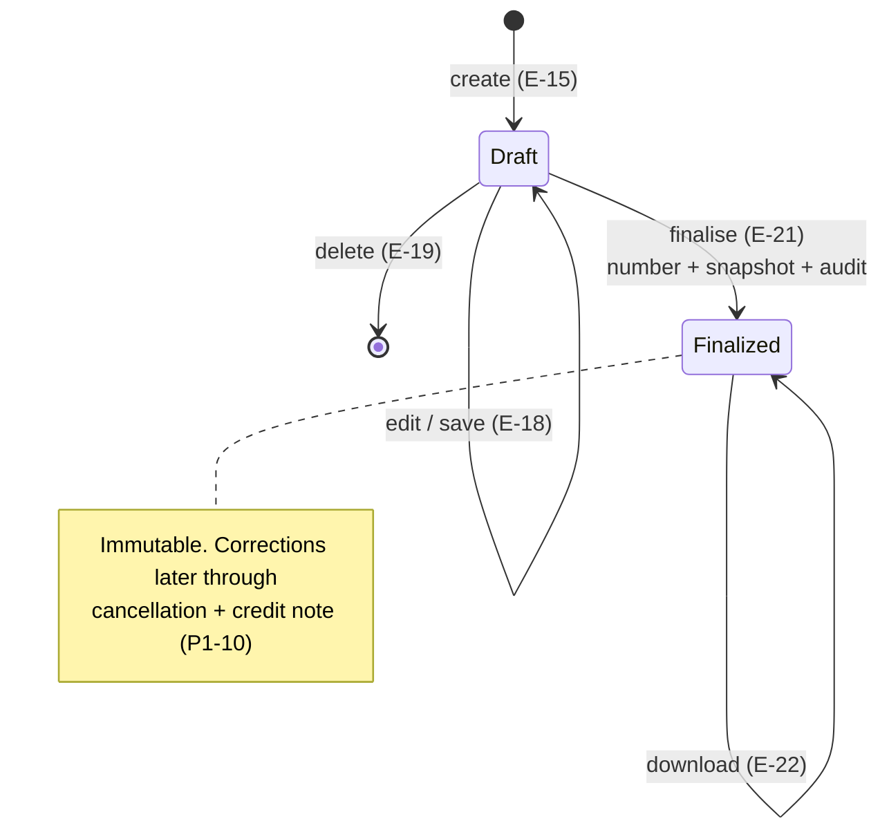
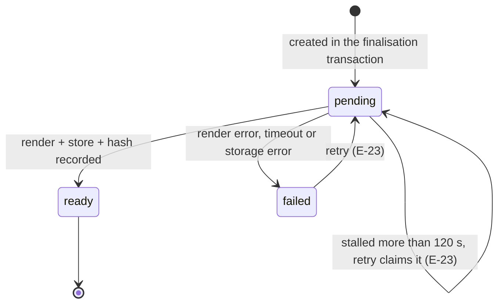

# 02 — Product Requirements Document (PRD)

| | |
| --- | --- |
| Document | PRD · version 1.1 · 23 November 2026 |
| Scope | P0-Lite in full detail; the full product summarised by phase (details in 03) |
| Read with | 03 (features), 07 (API), 09 (financial rules), 11 (acceptance) |

Requirement keywords: **MUST** means required for P0-Lite. **SHOULD** means expected, but may be reduced under the rules in 10 §6. **LATER** means a P1 or P2 requirement.

## 1. Problem definition

Owner-run service businesses need to issue invoices that are:

- arithmetically correct;
- consistently numbered;
- professionally presented;
- unchangeable once issued;
- easy to find and re-send.

Today they use general tools (word processors, spreadsheets, chat apps) that guarantee none of this (01 §3). P0-Lite proves the core of the solution on one document type, the invoice, without tax. The later phases extend the same pipeline to the other official document types.

## 2. User personas

Personas are fictional composites based on the research hypotheses. Pilot interviews must confirm them (Q-02, Q-09).

| ID | Persona | Context | Goals | Frustrations |
| --- | --- | --- | --- | --- |
| P-1 | **Asha**, owner of a six-person design studio in Bengaluru | Issues about 15 invoices a month to corporate clients from a Word template | Professional invoices in minutes; never send a wrong total; find last quarter's invoices quickly | Manual totals; numbers skipped after a deleted file; the client asks for "the original PDF" and she cannot be sure which one she sent |
| P-2 | **Imran**, independent IT consultant in Pune | Bills hours in fractions (2.5 h) and gives retainer clients a percentage discount | Exact amounts for fractional quantities and discounts; consistent numbering across the financial year | Spreadsheet rounding surprises; re-typing client details every time |
| P-3 | **Accounts clerk** at a client company (document recipient) | Receives and processes supplier invoices | Clear number, dates, line amounts and a total that adds up | Inconsistent formats; totals that do not match the lines |
| P-4 | **Payroll handler** (later, P2-01) | Prepares monthly salary slips | Accurate, private slips for staff | Sensitive data in spreadsheets |

## 3. User stories (P0-Lite)

Every P0-Lite story is MUST. The full checks are in 11 §3.

| ID | Story | Acceptance criteria | Features |
| --- | --- | --- | --- |
| US-01 | As a visitor, I want to understand what HIVE DOCS does and enter the system | The landing page explains the product; a short animation shows an invoice being assembled, calculated, finalised and stored; ENTER THE SYSTEM opens `/login`, or `/app` if already signed in | L-01 |
| US-02 | As the demonstration owner, I want to sign in and out securely | Valid credentials open the dashboard; invalid credentials show one generic message; signing out ends the server session; protected pages redirect to `/login` when signed out | L-02, L-03 |
| US-03 | As an owner, I want to enter my business details once | I can create the business profile (one per organization) and edit it later; invalid PIN code or GSTIN format shows field errors; edits never change issued invoices | L-04 |
| US-04 | As an owner, I want to add customers and find them again | I can create, list, search by name prefix and edit customers; a customer with existing invoices keeps its issued details on those invoices | L-05 |
| US-05 | As an owner, I want to prepare an invoice draft and come back to it later | I pick a customer, add up to 200 lines (description, quantity, unit, unit price, optional percent or fixed discount), add a due date, reference, notes and terms, and save; reloading shows the same draft; I can delete a draft | L-06 |
| US-06 | As an owner, I want totals I can trust | Line amounts and totals come from the server; the fixture lines give ₹1,800.00 and ₹900.00, total ₹2,700.00; invalid inputs are rejected with clear field messages | L-07 |
| US-07 | As an owner, I want to see the PDF before issuing it | Preview opens a PDF in the Classic template with a "DRAFT — NOT ISSUED" watermark, no invoice number and the exact SPECIMEN text | L-08, L-09 |
| US-08 | As an owner, I want to issue the invoice so that it gets a unique number and can no longer change | After confirming, the invoice receives the next number (for example `INV/26-27/00001`) and today's date in India; it becomes read-only; clicking twice never issues two numbers | L-10 |
| US-09 | As an owner, I want the issued PDF stored safely and identical every time I download it | The PDF is generated from the frozen snapshot, stored privately and downloadable; every download has the same SHA-256; if generation fails, Retry produces the PDF under the same number | L-11 |
| US-10 | As an owner, I want to browse my invoices and reopen any of them | The history lists drafts and issued invoices with number, customer, date, total and PDF status; I can filter by status, search by number or customer, and open any invoice | L-12, L-13 |
| US-11 | As an owner, I want my data visible only to my organization | Another organization's IDs behave as if they do not exist (404) | L-14 |
| US-12 | As an owner on a phone or a laptop, I want every screen to work | Screens work at 360 px, 768 px and 1280 px widths with keyboard access, visible loading, empty, success and error states, and reduced motion when requested | L-15 |

LATER stories (P1 and P2) are written when Heloavy confirms the composition of P1 (Q-06). Features are listed in 03 §4–5.

## 4. Functional requirements (P0-Lite)

| ID | Requirement | Feature | Endpoint |
| --- | --- | --- | --- |
| FR-01 | The landing page at `/` presents the product, a product-related animation and an ENTER THE SYSTEM button that navigates to `/login`, or to `/app` with a valid session | L-01 | E-05 |
| FR-02 | Sign-in with email and password; the password is verified against an Argon2id hash; any failure gives the same generic message | L-02 | E-03 |
| FR-03 | A successful sign-in creates a server-side session and sets the `ps5_session` cookie (HttpOnly, Secure, SameSite=Lax); sessions expire after 24 h idle or 7 days absolute | L-02 | E-03 |
| FR-04 | Sign-out revokes the session on the server and clears the cookie | L-02 | E-04 |
| FR-05 | After 5 failed sign-ins within 15 minutes for the same email, or from the same IP address, further attempts return 429 until the window passes | L-02 | E-03 |
| FR-06 | There is no public sign-up; the demonstration account is created only by the CLI command `create-demo-account` (05 §8) | L-02 | — |
| FR-07 | Every state-changing request needs a valid `X-CSRF-Token` and an allowed `Origin`; sign-in needs an allowed `Origin` | L-02 | all POST, PATCH, DELETE |
| FR-08 | The owner can create the business profile once per organization: legal name, optional trade name, address, state, PIN code, optional phone, email and GSTIN | L-04 | E-06 |
| FR-09 | The owner can view and edit the business profile; issued invoices keep the details frozen at issue | L-04 | E-07, E-08 |
| FR-10 | The owner can create a customer: display name (required), optional contact name, email, phone, address and GSTIN | L-05 | E-10 |
| FR-11 | The owner can list customers, newest first, with a case-insensitive name-prefix search and cursor pagination | L-05 | E-09 |
| FR-12 | The owner can view and edit a customer | L-05 | E-11, E-12 |
| FR-13 | The owner can create an invoice draft for one of the business's customers | L-06 | E-15 |
| FR-14 | A draft holds 0–200 lines (at least 1 to preview or finalise); each line has description, quantity, optional unit, unit price and a discount type of none, percent or amount with a value | L-06 | E-15, E-18 |
| FR-15 | A draft holds optional due date, reference, notes and terms; the issue date and number are assigned only at finalisation | L-06 | E-15, E-18 |
| FR-16 | Saving a draft uses optimistic concurrency (`ETag` / `If-Match`); a stale save returns 412 | L-06 | E-18 |
| FR-17 | The owner can delete a draft; finalised invoices cannot be deleted | L-06 | E-19 |
| FR-18 | The editor shows line amounts and totals from the server calculation endpoint, refreshed as the owner types (debounced); the browser never calculates authoritative money | L-06, L-07 | E-14 |
| FR-19 | The server calculates each line's gross, discount and line total, and the document's gross total, discount total and grand total, using `Decimal` and ROUND_HALF_UP to 2 decimal places (09 §3) | L-07 | E-14, E-17, E-21 |
| FR-20 | The server validates all inputs and limits (09 §4) and returns RFC 9457 problem details with a JSON pointer for each invalid field | L-07 | all |
| FR-21 | One free template, "Classic" (`classic@1`), is available and selected by default | L-08 | E-13 |
| FR-22 | Draft preview returns a PDF with a diagonal "DRAFT — NOT ISSUED" watermark, the SPECIMEN text and no number; preview PDFs are not stored | L-09 | E-20 |
| FR-23 | Finalisation requires an `Idempotency-Key` and `If-Match`, and runs as one database transaction (09 §8) | L-10 | E-21 |
| FR-24 | Numbers follow `INV/{FY}/{sequence}` per business and financial year, for example `INV/26-27/00001`, at most 16 characters | L-10 | E-21 |
| FR-25 | Finalisation stores an immutable snapshot of the seller, buyer, lines, totals and versions as canonical JSON with its SHA-256 | L-10 | E-21 |
| FR-26 | Finalised invoices, their lines and snapshots cannot be changed or deleted: the API returns 409 and database triggers reject changes | L-10 | E-18, E-19 |
| FR-27 | Finalisation writes a `document.finalized` audit event in the same transaction | L-10 | E-21 |
| FR-28 | After the transaction commits, the server renders the final PDF from the snapshot, stores it in private object storage and records its SHA-256 and size | L-11 | E-21 |
| FR-29 | If rendering or storage fails, the invoice stays finalised with PDF status `failed`; Retry renders again with the same number and snapshot | L-11 | E-23 |
| FR-30 | Download returns the stored PDF only after checking its SHA-256 against the recorded value; it never re-renders silently | L-11, L-12 | E-22 |
| FR-31 | The history lists the business's invoices (number, customer, status, issue date, grand total, PDF status), newest first, filtered by status, searched by number or customer name prefix, with cursor pagination | L-12 | E-16 |
| FR-32 | The document page shows a draft in the editor, or an issued invoice read-only with its lines, totals, snapshot hash, PDF status and Download and Retry actions | L-12 | E-17 |
| FR-33 | The dashboard shows quick actions (new invoice, new customer) and the five most recent invoices | L-13 | E-16 |
| FR-34 | Every request takes the organization from the session; a business, customer or document ID belonging to another organization returns 404 | L-14 | all tenant endpoints |
| FR-35 | Every screen has loading, empty, success and error states; errors show a plain message and the request ID | L-15 | — |
| FR-36 | Screens are responsive at 360, 768 and 1280 px, keyboard-operable, and honour `prefers-reduced-motion` | L-15 | — |
| FR-37 | `GET /healthz` reports that the process is alive; `GET /readyz` checks the database, object storage and template integrity | L-16 | E-01, E-02 |
| FR-38 | A Docker Compose stack runs the application with PostgreSQL and S3-compatible storage on persistent volumes | L-16 | — |
| FR-39 | Audit events are recorded for sign-in success and failure, sign-out, business and customer create and update, finalisation, PDF render result and PDF download (06 §3.15) | L-02, L-04, L-05, L-10, L-11 | — |

## 5. Non-functional requirements

| ID | Requirement | Target (P0-Lite) | Verified by |
| --- | --- | --- | --- |
| NFR-01 | Money correctness | No binary floating-point anywhere in the money path: `NUMERIC` in the database, `Decimal` in Python, decimal strings in JSON, string formatting in the browser | UT-CALC, code review |
| NFR-02 | Durability | Data and PDFs survive application and container restarts; PDFs never live on the container filesystem | DC-17 |
| NFR-03 | Integrity | Snapshot and PDF SHA-256 recorded and verified; finalised records protected by database triggers | UT-SNAP, IT-PDF-02, DB-03 to DB-07 |
| NFR-04 | Security | The baseline in 12, including secure sessions, CSRF protection, tenant scoping, safe rendering and no secrets in source control | UT-SEC, IT-AUTH, IT-TEN, IT-PDF-05 (11 §2) |
| NFR-05 | Privacy | Synthetic data only in P0-Lite; no real personal data stored | Demonstration data review (11 §5) |
| NFR-06 | Performance (local, targets) | Calculation endpoint p95 under 300 ms; preview of 20 lines under 5 s; finalisation response under 1 s, with the PDF ready within 10 s; list pages under 500 ms with 1,000 invoices | Manual timing in M8 |
| NFR-07 | Availability | Demonstration-grade single instance; no service-level agreement | — |
| NFR-08 | Accessibility | WCAG 2.2 AA as the target for P0-Lite screens (not certified) | FE-04 checklist |
| NFR-09 | Browser support | Current Chrome, Edge, Firefox and Safari on desktop; Chrome on Android; minimum width 360 px; the demonstration uses desktop Chrome | FE-04 |
| NFR-10 | Maintainability | Module boundaries as in 04 §3; type checks (mypy, tsc) and linters (ruff, ESLint) pass | FE-01, FE-02, backend lint |
| NFR-11 | Observability | Structured JSON logs carrying a request ID; no passwords, tokens, cookies or full addresses in logs | Log review in M8 |
| NFR-12 | Configuration | All settings and secrets from environment variables; startup fails when a required setting is missing | IT-HLT-01, M0 |
| NFR-13 | Locale | Amounts in Indian rupees with Indian digit grouping (₹1,23,456.78); dates shown as DD MMM YYYY (25 Nov 2026) | UT-FMT-01, DC-07 |
| NFR-14 | Time | Timestamps stored in UTC (`timestamptz`); document dates use Asia/Kolkata | UT-NUM-01 |

## 6. User journeys

**J-1 First-time setup (owner).**

1. Landing page.
2. ENTER THE SYSTEM.
3. Sign in.
4. The dashboard shows a "Set up your business" call to action.
5. The owner completes the business profile and saves.
6. The dashboard now offers New customer and New invoice.

**J-2 Create and issue an invoice.**

1. New invoice.
2. Choose a customer, or create one in a dialog.
3. Add lines; totals update from the server.
4. Save draft.
5. Preview: the PDF opens in a preview dialog with the watermark.
6. Finalise, then confirm in a dialog that states the action cannot be undone.
7. The number and date are shown and the status becomes Finalised.
8. "Generating PDF…" changes to Ready.
9. Download.

**J-3 Retrieve and re-send.** Invoices → filter Finalised → search by customer prefix → open → Download. The file is byte-identical to the first download.

**J-4 Recover from a PDF failure.**

1. Finalise while storage is unavailable.
2. The invoice is Finalised and the PDF shows Failed with a Retry button.
3. Storage comes back; the owner selects Retry.
4. The PDF becomes Ready with the same number.

**J-5 Session expiry.** An action after 24 hours idle returns 401. The app redirects to `/login` with "Your session ended. Please sign in again." and returns to the original page afterwards.

## 7. Business rules

Full detail and examples are in 09. Rules marked **CA** need a chartered accountant's validation before production use.

| ID | Rule |
| --- | --- |
| BR-01 | The organization is the tenant and the business is the issuer. P0-Lite allows exactly one business per organization. |
| BR-02 | Money has 2 decimal places. Each line is rounded with ROUND_HALF_UP; document totals are sums of rounded line values. **CA** |
| BR-03 | Quantity is greater than 0 and at most 1,000,000, with up to 3 decimal places. |
| BR-04 | Unit price is from ₹0.00 to ₹1,00,00,000.00 (₹1 crore), with up to 2 decimal places. |
| BR-05 | A percent discount is greater than 0 and at most 100, with up to 2 decimals. An amount discount is greater than ₹0.00 and at most the line's gross amount. |
| BR-06 | A draft has 0–200 lines; previewing or finalising needs at least 1. The grand total is at most ₹9,999,999,999,999.99. |
| BR-07 | Numbers are allocated per business, per document type and per financial year. They are consecutive; a rolled-back finalisation consumes no number. **CA** |
| BR-08 | The financial year runs from 1 April to 31 March and is labelled `YY-YY`, for example `26-27`. The issue date is the finalisation date in Asia/Kolkata; backdating is not allowed. |
| BR-09 | Finalisation requires: draft status, 1–200 valid lines, a grand total greater than ₹0.00 and within the limit, a due date (if set) on or after the issue date, and an active template. |
| BR-10 | Finalised documents, their lines and snapshots are immutable while they are retained. Corrections come later through cancellation and credit notes (P1-10). Retention duration and deletion follow the Heloavy-approved policy and the applicable legal requirements (Q-18, 12 §16). |
| BR-11 | The snapshot freezes seller and buyer details at finalisation; later profile or customer edits do not affect issued documents. |
| BR-12 | A finalised document's PDF is rendered only from its snapshot. The stored file is what every download returns. Retries never renumber. |
| BR-13 | Every PDF, preview or final, contains exactly: "SPECIMEN — demonstration document, not a tax invoice." |
| BR-14 | P0-Lite documents use tax mode `no_tax`. PDFs are titled "Invoice", never "Tax Invoice", and show no GST figures. |
| BR-15 | Draft previews carry a "DRAFT — NOT ISSUED" watermark and no number. |
| BR-16 | IDs from another organization behave as non-existent (404). |
| BR-17 | Currency is INR only; customers are in India in P0-Lite. |
| BR-18 | Amount in words (stretch S-05) uses the Indian numbering system (lakh, crore). |

## 8. Document lifecycle

The final PDF artifact of a finalised document has its own lifecycle:

## 9. Acceptance criteria (P0-Lite)

P0-Lite is an aggressive, conditional target (10 §1). It is accepted when:

1. All MUST features L-01 to L-16 meet their acceptance conditions in 03 §2.
2. The automated suites listed as never-cut in 11 §1 pass on the frozen build.
3. The mandatory demonstration checks DC-01 to DC-20 (11 §3) pass on the demonstration machine.
4. No screen shows an out-of-scope feature, and no claim of GST compliance appears anywhere.
5. PROGRESS.md records every MUST item as done, or as deferred with a reason. A deferred item is removed from the live script.

Full-product acceptance tests (AT-xx) are listed in 11 §4 and apply to P1 and P2.

## 10. Dependencies

| Dependency | Type | Needed for | Status |
| --- | --- | --- | --- |
| Answers to Q-14 (local demonstration acceptable) and Q-15 (logistics) | Client | Demonstration format | Open; working assumption A-03 |
| WeasyPrint 70.x and its system libraries in the container | Technical | L-09, L-11 | De-risked in M0 (V-06) |
| S3-compatible storage: SeaweedFS locally, Spaces when deployed | Technical | L-11 | SeaweedFS must pass the M0 verification gate (V-07, V-08, V-18, V-19; 05 §14.1) |
| PostgreSQL 16 | Technical | Everything | Local container |
| Bundled fonts (Noto Sans, Noto Sans Devanagari, Inter, Source Serif 4) | Asset | L-08, L-15 | Downloaded in M0 (OFL licences kept alongside) |
| Chartered accountant review | Professional | GST (P1-05), rounding, numbering, retention | Not identified (Q-03) |
| Heloavy decisions Q-01 to Q-12 | Client | P1 scope and production | Open |

## 11. P0-Lite versus the full product

| Official requirement | P0-Lite (25 November) | Full product |
| --- | --- | --- |
| Invoices | **Yes**: no-tax invoices with the full draft → finalise → PDF → history lifecycle | GST after CA approval (P1-05); cancellation and credit notes (P1-10); e-invoicing (P2-06) |
| Bills | No | P1-09, once "bill" is defined (Q-13) |
| Receipts | No | P1-06 |
| Payment requests | No | P1-07 |
| Salary slips | No | P2-01, with a payroll privacy module (Q-22) |
| Free templates | One (Classic); a second is stretch (S-01) | More free templates |
| Premium templates | No | P1-04, with plans (Q-08) |
| Business profiles and branding | Profile details printed on the PDF | Logo upload (P1-03); more branding later |
| Automatic calculations | **Yes**: quantity × price, percent and fixed discounts, totals | Tax, round-off and more (P1-05, Q-17) |
| PDF generation | **Yes**: watermarked preview and stored final PDF | Same pipeline for every document type |
| Document management and history | **Yes**: history, search, filter, reopen, download | Exports (P1-12), duplicate (P1-11), archive (P1-13) |
| Subscription plans and usage limits | No | P1-04 |
| Modular extensibility | Architecture only: document-type field, modules, versioned templates and calculation | New document types plug into the same pipeline |
