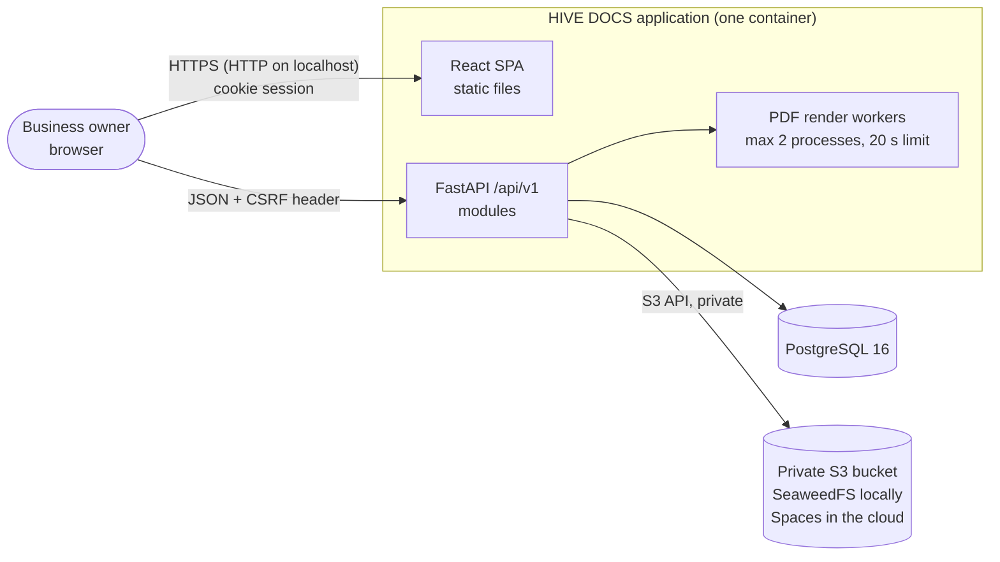
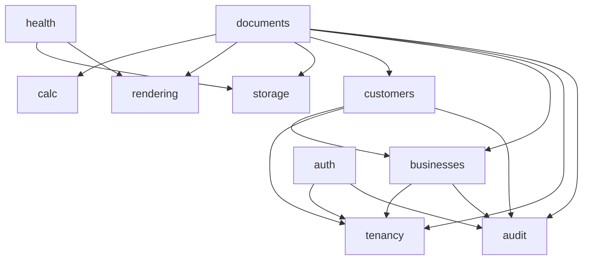
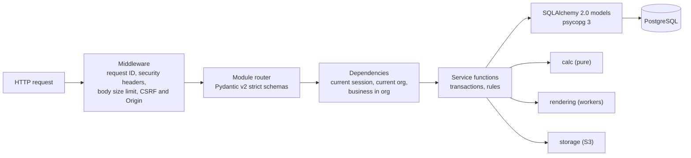
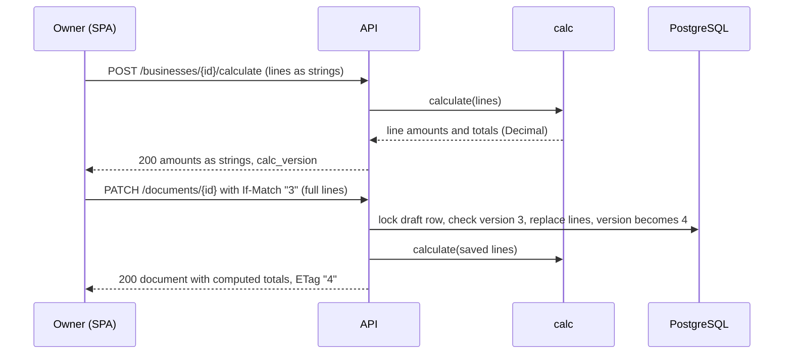
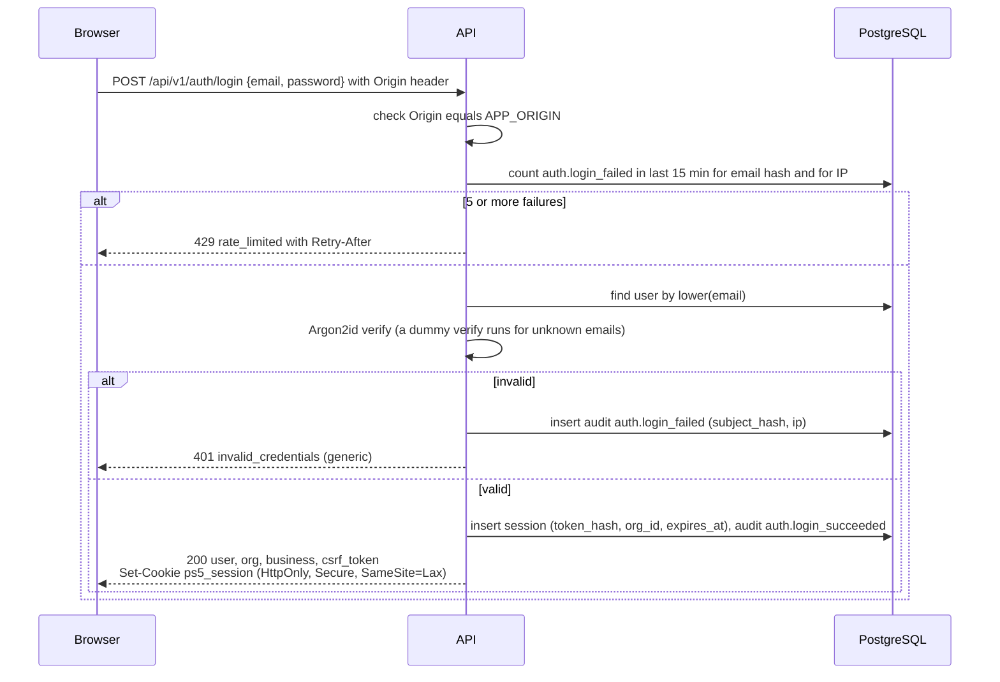
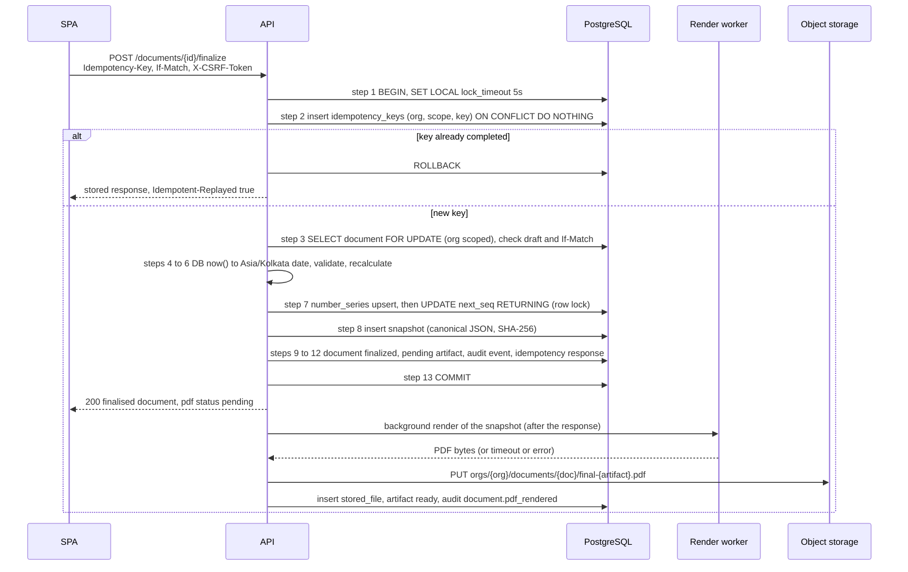
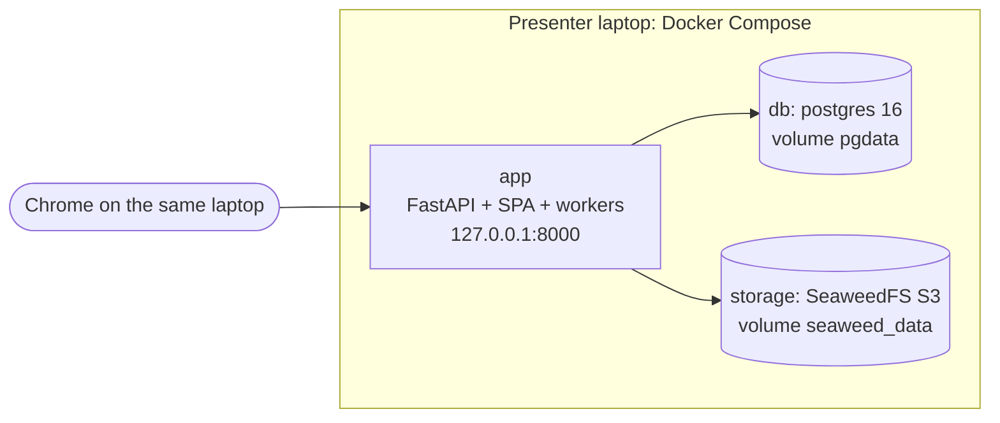
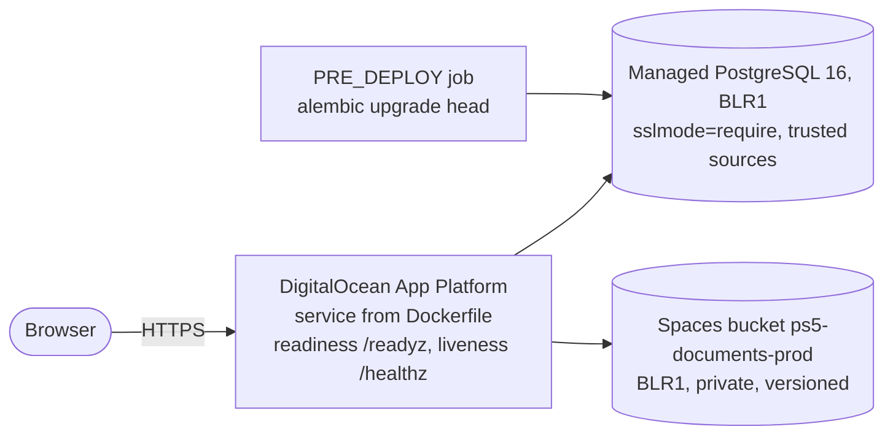

# 04 — Architecture

| | |
| --- | --- |
| Document | Architecture · version 1.1 · 23 November 2026 |
| Baseline | Revision 2 with the Revision 2.1 errata and frozen decisions, narrowed to P0-Lite |
| Normative companions | 06 (schema), 07 (API), 09 (financial and finalisation rules). Where this document summarises them, they win |

## 1. System overview

HIVE DOCS is one **modular monolith**: a single FastAPI application that also serves the built React single-page application (SPA). It has two backing services: PostgreSQL 16 and private S3-compatible object storage. The application never makes outbound network calls, apart from storage and the database.

| Runtime element | Responsibility | Not responsible for |
| --- | --- | --- |
| React SPA | Screens, forms, navigation, displaying server results | Calculating money, authorising access, deciding state transitions |
| FastAPI application | Authentication, validation, calculation, persistence, finalisation, rendering orchestration, downloads | Serving public file URLs; calling external services |
| Render workers | Turning snapshot data into PDF bytes with WeasyPrint | Database or storage access; network access |
| PostgreSQL | Durable records, constraints, triggers, numbering counters | Storing PDF bytes |
| Object storage | Durable private PDF objects | Access control decisions (the API decides) |

## 2. Request paths

| Path | Served by | Notes |
| --- | --- | --- |
| `/`, `/login`, `/app/...` | The SPA's `index.html` plus hashed assets | Client-side routing; unknown `/app` routes render the SPA 404 page |
| `/api/v1/...` | FastAPI routers | JSON; problem+json errors; `Cache-Control: no-store` |
| `/healthz`, `/readyz` | FastAPI health module | No `/api/v1` prefix (Revision 2.1 errata) |
| `/assets/...` | Static files built by Vite | Long cache lifetime; hashed filenames |

Same-origin serving keeps the session cookie first-party and makes CSRF checks simple (ADR-02).

## 3. Modular monolith boundaries

Folder layout: 05 §4. Each module owns its models, schemas, services and routes. Other modules call it only through its service functions, never through its tables directly.

| Module | Owns | Endpoints | May depend on |
| --- | --- | --- | --- |
| `core` | Settings, database engine and transactions, problem+json errors, logging, request-ID middleware, security headers, in-memory rate limiter, clock | — | — |
| `audit` | `audit_events`; recording events; counting login failures | — | core |
| `tenancy` | `organizations`, `memberships`; the "current organization" dependency; scope helpers | — | core |
| `auth` | `users`, `sessions`; Argon2id; session cookies; CSRF; login throttling; `create-demo-account` | E-03, E-04, E-05 | core, tenancy, audit |
| `businesses` | `businesses`; profile validation | E-06, E-07, E-08 | core, tenancy, audit |
| `customers` | `customers` | E-09 to E-12 | core, tenancy, businesses, audit |
| `calc` | Pure `Decimal` calculation functions and limits (`calc-1.0.0`) | — | nothing (no I/O) |
| `rendering` | `templates` table and the template registry (files plus expected SHA-256); Jinja2 environment; restricted URL fetcher; worker pool | E-13 | core |
| `storage` | `stored_files`; the S3 client; object keys; integrity checks | — | core |
| `documents` | `documents`, `document_lines`, `number_series`, `document_snapshots`, `document_artifacts`, `idempotency_keys`; drafts, numbering, finalisation, snapshot canonicalisation, PDF orchestration | E-14 to E-23 | core, tenancy, businesses, customers, calc, rendering, storage, audit |
| `health` | Liveness and readiness checks | E-01, E-02 | core, storage, rendering |

Boundary rules:

1. `calc` performs no I/O and imports nothing from other modules. Its functions take `Decimal` values and return `Decimal` values.
2. `rendering` never touches the database or storage. It receives a plain payload and returns PDF bytes.
3. Only `storage` talks to S3, and only `documents` calls `storage` in P0-Lite.
4. Every query on tenant-owned data filters by the session's `org_id`. Each module's service functions take `org_id` as their first argument.
5. No module reads another module's tables with raw SQL. The one exception is the documents list query, which joins `customers` and `document_snapshots` read-only.

## 4. Frontend architecture

| Concern | Decision |
| --- | --- |
| Structure | `src/app` (router, providers), `src/api` (HTTP client, query keys, endpoint functions), `src/features/<feature>` (pages and feature components for landing, auth, dashboard, business, customers, invoices, templates), `src/components/ui` (wrappers around Radix primitives), `src/lib` (money and date formatting, Zod schemas, idempotency keys), `src/styles` |
| Routing | React Router. Public: `/`, `/login`. Protected under `/app` (08 §12). A route guard reads `['me']` and redirects to `/login?next=` on 401 |
| Server state | TanStack Query. Keys: `['me']`, `['business', id]`, `['customers', businessId, params]`, `['customer', id]`, `['documents', businessId, params]`, `['document', id]`, `['templates']`. Mutations invalidate the affected keys |
| Forms | React Hook Form with Zod schemas that mirror the server limits in 09 §4, for instant feedback. The server stays authoritative; its `errors[].pointer` values are mapped back onto fields |
| API client | `fetch` wrapper: `credentials: 'same-origin'`; JSON in and out; adds `X-CSRF-Token` to POST, PATCH and DELETE; `If-Match` from the cached ETag; parses problem+json; a 401 clears `['me']` and redirects |
| CSRF token | Returned by E-03 and E-05; kept in memory only (query cache), never in `localStorage` |
| Money | Decimal strings end to end. Inputs are text fields (`inputmode="decimal"`). Display uses a string-based Indian-grouping formatter. Money strings are never converted to `Number` |
| Live totals | The editor posts the current lines to E-14, debounced by 400 ms. Responses older than the latest request are ignored |
| Idempotency | Each Finalise confirmation generates one `crypto.randomUUID()` key, reused for automatic retries of that same attempt |
| PDF status | After finalising, `['document', id]` polls every 1.5 s while `pdf.status` is `pending`, stopping after 60 s |
| Styling | Tailwind with design tokens as CSS variables (08 §4); Radix for dialogs, dropdowns, toasts, tooltips and selects |
| No business logic | The SPA never decides numbering, totals, permissions or immutability; it only displays what the API returns |

## 5. Backend architecture

- **Application factory:** `create_app()` loads settings (it fails at startup if a required variable is missing, 05 §9). It registers middleware and routers, mounts the SPA, and checks the template registry.
- **Database:** SQLAlchemy 2.0 with psycopg 3, synchronous sessions. FastAPI runs synchronous endpoints in its thread pool, which keeps transaction code simple. There is one session per request, with explicit `with session.begin():` blocks. Isolation is READ COMMITTED; finalisation adds `SET LOCAL lock_timeout = '5s'`.
- **Validation:** Pydantic v2 in strict mode for request bodies. Money and quantity fields must be JSON strings, converted to `Decimal` by a custom validator. Unknown fields are rejected (`extra = 'forbid'`).
- **Errors:** one exception hierarchy (`AppError(code, status, detail, errors)`) rendered as RFC 9457 problem+json (07 §1.5). Unexpected exceptions become 500 `internal_error`, with the traceback logged server-side only.
- **Middleware order:** request ID → security headers → body size limit (256 KiB) → Origin and CSRF check for unsafe methods → routing.
- **Clock:** one injectable clock. Finalisation takes `now()` from the database, so `finalized_at` and the issue date come from the same instant.
- **Logging:** JSON lines with `ts`, `level`, `request_id`, `org_id`, `user_id`, `route`, `status` and `duration_ms`. Never secrets or document contents (12 §10).
- **Background work:** FastAPI `BackgroundTasks` runs the post-commit PDF render. There is no external queue in P0-Lite (ADR-10).

## 6. Data flow: editing a draft

Drafts store inputs only (quantity, price, discount). Computed amounts are derived on every read and frozen only in the snapshot at finalisation (09 §9).

## 7. Authentication flow

Every later request resolves the session as follows:

1. Read `ps5_session` and hash it with SHA-256.
2. Find a session row that is not revoked and not expired.
3. Enforce the 24 h idle and 7 day absolute expiry, then refresh `last_seen_at` (at most once a minute).
4. Load the membership and organization.

Unsafe methods also check `X-CSRF-Token` against HMAC-SHA256(`CSRF_SECRET`, session ID) in constant time, and check that `Origin` equals `APP_ORIGIN` (12 §4).

## 8. Tenant isolation

Isolation is enforced in five layers:

1. **Identity:** `org_id` comes only from the session. Request bodies never carry `org_id`; extra fields are rejected.
2. **Lookup:** every path ID is resolved with `WHERE id = :id AND org_id = :org_id`. Nested IDs are resolved inside their parent, for example a customer inside the business. A miss returns 404 `not_found`, whether the record does not exist or belongs to someone else.
3. **Database relationships:** composite foreign keys make cross-tenant references impossible even if application code has a bug (06 §4). Examples are `(business_id, org_id)` → `businesses (id, org_id)` and `(customer_id, business_id)` → `customers (id, business_id)`.
4. **Storage:** object keys begin with `orgs/{org_id}/`. There are no public or presigned URLs; downloads are proxied by the API after the same lookup checks.
5. **Tests:** IT-TEN runs every tenant endpoint with a second organization's session (11 §2.5).

PostgreSQL row-level security is a P1 hardening step (P1-14, ADR-03).

## 9. Invoice lifecycle

The state diagrams are in 02 §8. The operations allowed in each state:

| Operation | Draft | Finalised |
| --- | --- | --- |
| View (E-17) | Yes (amounts computed live) | Yes (from the snapshot) |
| Edit (E-18) | Yes, with `If-Match` | 409 `document_not_draft` |
| Delete (E-19) | Yes, with `If-Match` | 409 `document_not_draft` |
| Preview (E-20) | Yes | 409 `document_not_draft` |
| Finalise (E-21) | Yes | 409 `document_not_draft`; a replay with the same key returns the stored response |
| Download (E-22) | 409 `document_not_finalized` | Yes when the PDF is `ready`; otherwise 409 `pdf_not_ready` |
| Retry PDF (E-23) | 409 `document_not_finalized` | Yes when `failed`, or `pending` for more than 120 s |

## 10. Atomic finalisation

The normative step list is in 09 §8. This diagram shows the locks and ordering.

| Property | How it is guaranteed |
| --- | --- |
| One number per document | Status check under `FOR UPDATE`; `UNIQUE (business_id, doc_type, document_number)`; the guard trigger |
| No duplicate numbers under concurrency | The counter row is updated inside the transaction; the row lock serialises finalisations for the same business and year; `UNIQUE (number_series_id, sequence_no)` |
| No gaps from failures | The counter update rolls back with the transaction |
| No duplicate issue from double clicks or retries | Idempotency record in the same transaction; replay returns the stored response |
| Deadlock avoidance | Fixed lock order: idempotency record → document → number series |
| Bounded waiting | `lock_timeout` 5 s; a lock timeout returns 409 `idempotency_in_progress` when waiting on the idempotency record, otherwise 503 `dependency_unavailable` |

## 11. PDF rendering lifecycle

1. **Input:** the snapshot payload (final) or a preview payload of the same shape built from the draft (with `number` null and the watermark flag on).
2. **Template:** Jinja2 with `autoescape=True` and `StrictUndefined`, loading only from the registered template directory, such as `rendering/templates/invoice/classic/v1/`. Before rendering, the template files' SHA-256 must equal the registry value.
3. **HTML to PDF:** WeasyPrint 70.x in a separate worker process (the `spawn` start method). At most `RENDER_WORKERS` (2) run at once, and any render exceeding `RENDER_TIMEOUT_S` (20 s) is terminated. Options:
   - `presentational_hints` off;
   - no attachments;
   - a custom `url_fetcher` that serves only files inside the bundled assets directory (fonts and CSS) and rejects every other URL, including `http:`, `https:`, `ftp:` and any `file:` path outside the assets directory;
   - no network access in the container path used by rendering.
4. **Output (final only):**
   - compute the SHA-256 and size;
   - PUT the object with `ContentType: application/pdf`;
   - record `stored_files` and set the artifact to `ready` with `renderer_version` and `template_sha256`;
   - write the audit event `document.pdf_rendered`.
5. **Output (preview):** the bytes are returned directly with `Content-Disposition: inline` and never stored.

## 12. Failure and retry handling

| Failure | Effect | Recovery |
| --- | --- | --- |
| Validation fails during finalisation | 422 `finalization_blocked`; the transaction rolls back; no number used | Fix the draft, then finalise again (a new key is fine) |
| Lock timeout on the idempotency record | 409 `idempotency_in_progress` | The SPA waits 2 s and retries with the same key |
| Process crash before COMMIT | Nothing persisted | Retry with the same key re-executes |
| Process crash after COMMIT, before the render | Document finalised; artifact `pending` | After 120 s, the details page shows Retry → E-23 |
| Render error or 20 s timeout | Artifact `failed` (`render_error` or `render_timeout`); audit `document.pdf_render_failed` | Retry (E-23), same number and snapshot |
| Storage PUT fails | Artifact `failed` (`storage_error`) | Retry after storage recovers (DC-18) |
| Storage object altered or missing | Download returns 500 `integrity_check_failed` (or 503 when storage is unreachable); logged at ERROR | Investigate. An operator re-render is a P1 tool, and the record is never edited silently |
| Database unavailable | `/readyz` 503; API 503 `dependency_unavailable` | Restore the database; no data lost when volumes are kept |

## 13. Storage architecture

| Aspect | Decision |
| --- | --- |
| Interface | S3 API through boto3, the only storage implementation; there is no filesystem fallback. Startup fails without S3 settings |
| Local | SeaweedFS (`chrislusf/seaweedfs`, pinned by tag and digest) with S3 on port 8333 and identities configured so anonymous access is refused. It must pass the M0 verification gate: pinned image and command, bucket initialization, authenticated PUT/GET, anonymous access refused (05 §14.1) |
| Cloud reference | DigitalOcean Spaces, region `blr1`, endpoint `https://blr1.digitaloceanspaces.com`, bucket `ps5-documents-prod`, private, versioning enabled through the API (V-10) |
| Object key | `orgs/{org_id}/documents/{document_id}/final-{artifact_id}.pdf` |
| Access | No public ACLs, no presigned URLs; the API streams the object after authorisation and hash checks |
| Integrity | SHA-256 recorded in `stored_files.sha256` and checked on every download |
| Encryption | Spaces offers only customer-provided keys (SSE-C), so P0 stores synthetic data only. Production encryption is decided in P1-14 (12 §8) |
| Durability | Named Docker volume locally; managed object storage in the cloud; never the container filesystem |
| Retention | A `ready` PDF is never replaced or edited. How long PDFs are retained, and how they are deleted, follows the retention policy Heloavy approves and the applicable legal requirements (Q-18, 12 §16); retention-based deletion is not part of P0-Lite |

## 14. Deployment architecture

### 14.1 Local demonstration runtime (guaranteed path, MUST)

No internet is needed at runtime. Ports are bound to 127.0.0.1. Details: 05 §7.

### 14.2 Cloud reference (S-02 stretch; basis for P1)

Secrets are encrypted App Platform environment variables. The migration job uses `MIGRATION_DATABASE_URL`, and the service uses the restricted `DATABASE_URL` (06 §11). Platform field names must be verified (V-10).

### 14.3 Production (P1-14)

The cloud reference, plus: backups with point-in-time recovery and a restore drill, monitoring and alerts, row-level security, MFA, document encryption, edge rate limiting and a DPDP review. Hosting ownership and providers need Heloavy's decision (Q-04, Q-05).

## 15. Extensibility: adding a document type later

Receipts, payment requests, bills and salary slips plug into the same pipeline:

1. Add the type to the `doc_type` check constraints and to `number_series` (its own prefix, such as `RCT`).
2. Add a payload schema version and a calculation function, if the type has amounts.
3. Add a template directory (`rendering/templates/<type>/<name>/v1/`) with its registry hash.
4. Reuse drafts, finalisation, snapshots, artifacts, storage and audit unchanged.
5. Salary slips additionally need the payroll privacy module (P2-01, 12 §13).

## 16. Architecture decision records

| ID | Decision | Context | Consequences and trade-offs |
| --- | --- | --- | --- |
| ADR-01 | Modular monolith (one FastAPI app) | One developer; mandatory decision 1 | Simple deployment and transactions. Module boundaries must be kept by discipline and review, because there is no network boundary enforcing them |
| ADR-02 | SPA served by the same deployment (same origin) | Cookie sessions and CSRF | First-party cookies, no CORS configuration. Frontend and backend deploy together |
| ADR-03 | PostgreSQL 16 with composite-key tenancy; row-level security deferred | Mandatory decision 14 within P0-Lite effort | Strong relational isolation now. Row-level security adds defence in depth in P1-14 |
| ADR-04 | Server-side sessions in the database, not JWTs | Need for instant revocation and simple CSRF | One indexed lookup per request; easy logout and expiry |
| ADR-05 | Pure `Decimal` calculation module, versioned `calc-1.0.0` | Correctness and auditability | Totals reproducible from inputs. A rule change means a new `calc_version`; snapshots keep the old one |
| ADR-06 | Immutable snapshot (canonical JSON + SHA-256) at finalisation, protected by triggers | Mandatory decisions 7–9 | Issued documents are independent of later edits. The JSON payload carries some redundancy, which is accepted |
| ADR-07 | Counter row (`UPDATE … RETURNING`) for numbering instead of PostgreSQL sequences | Sequences are not transactional and leave gaps | Gap-free, transactional numbers. Finalisations for the same business and year serialise briefly, which is acceptable at this scale |
| ADR-08 | Idempotency keys stored in the database, inside the finalisation transaction | Double clicks and network retries | Exactly-once issuance. A key expires after 24 h; a purge job is P1 |
| ADR-09 | Jinja2 + WeasyPrint in isolated worker processes, restricted fetcher, bundled fonts | Real PDFs; untrusted text in templates | Deterministic offline rendering. WeasyPrint system libraries must be installed in the image (V-06) |
| ADR-10 | Render after commit, using background tasks with retry; no external queue | Keep P0-Lite small; rendering must not block numbering | A crash can leave `pending`; the 120 s retry rule covers it. A durable job queue is P1 |
| ADR-11 | No tax in P0-Lite; GST behind a CA approval gate | Mandatory decisions 17–18 | An honest demonstration. GST work is P1-05 |
| ADR-12 | Local Docker is the guaranteed demonstration runtime; cloud deployment is stretch | Solo capacity and demonstration risk | Works offline. Evaluators may want a URL (Q-14) |
| ADR-13 | SeaweedFS instead of MinIO for local S3 | Revision 2.1 found MinIO's community container images no longer reliably maintained (verify current status) | Same S3 code path everywhere. Retained by team decision on 23 November 2026 (C-01, 14 §4), subject to the M0 verification gate (05 §14.1) |
