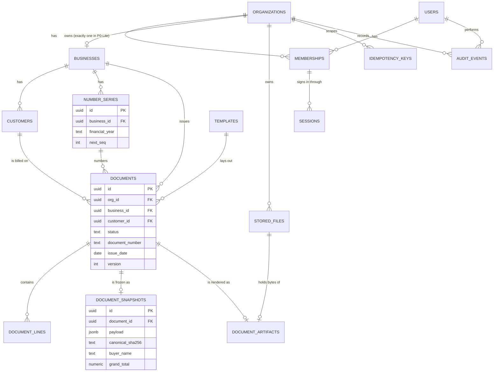

# 06 — Database Schema (PostgreSQL 16)

| | |
| --- | --- |
| Document | P0-Lite schema · version 1.1 · 23 November 2026 |
| Tables | **15** in P0-Lite. Plans, entitlements, subscriptions, usage counters, GST, logo and archive structures are deferred (§13) |
| Rule | Every index, constraint and trigger below refers only to columns defined in this document. Migrations must reproduce these names exactly |

## 1. Conventions

- **Keys:** `uuid` primary keys with default `gen_random_uuid()` (built into PostgreSQL 13+). The exceptions are `templates.id` (text, for example `classic@1`), `audit_events.id` (`bigint` identity) and the composite key of `idempotency_keys`.
- **Time:** `timestamptz` in UTC. Calendar dates (`issue_date`, `due_date`) are `date` values in Asia/Kolkata.
- **Money and quantities:** `numeric(p,s)` only; never `real`, `double precision` or `money` (§5).
- **Enumerations:** `text` columns with `CHECK` constraints, which are easier to widen in later migrations than PostgreSQL enum types.
- **Text lengths:** enforced with `CHECK (char_length(col) …)`. The API enforces the same limits (09 §4).
- **Timestamps:** `created_at` and `updated_at` are `timestamptz NOT NULL DEFAULT now()` on every mutable table. The application sets `updated_at` on update; there is no trigger for it.
- **Optimistic concurrency:** `version integer NOT NULL DEFAULT 1 CHECK (version >= 1)` on `businesses`, `customers` and `documents`. It increments on every update and is exposed as the ETag (07 §1.6).
- **Deletes:** foreign keys use `ON DELETE RESTRICT` unless stated. Only draft lines cascade from their draft.

## 2. Entity relationship diagram



## 3. P0-Lite tables

The tables are listed in dependency order. A table is tenant-owned when it carries `org_id` (§4).

### 3.1 `organizations` (tenant root)

| Column | Type | Null | Default | Constraints and notes |
| --- | --- | --- | --- | --- |
| `id` | uuid | no | `gen_random_uuid()` | PK `organizations_pkey` |
| `name` | text | no | | `CHECK (char_length(name) BETWEEN 1 AND 200)` |
| `created_at` | timestamptz | no | `now()` | |
| `updated_at` | timestamptz | no | `now()` | |

### 3.2 `users`

| Column | Type | Null | Default | Constraints and notes |
| --- | --- | --- | --- | --- |
| `id` | uuid | no | `gen_random_uuid()` | PK |
| `email` | text | no | | `CHECK (char_length(email) BETWEEN 3 AND 254)`; stored trimmed and lower-cased by the app |
| `password_hash` | text | no | | Argon2id PHC string; `CHECK (password_hash LIKE '$argon2id$%')` |
| `display_name` | text | no | | `CHECK (char_length(display_name) BETWEEN 1 AND 120)` |
| `is_active` | boolean | no | `true` | Inactive users cannot sign in |
| `last_login_at` | timestamptz | yes | | |
| `created_at` / `updated_at` | timestamptz | no | `now()` | |

Index: `users_email_lower_uq` UNIQUE on `(lower(email))`.

### 3.3 `memberships`

| Column | Type | Null | Default | Constraints and notes |
| --- | --- | --- | --- | --- |
| `org_id` | uuid | no | | FK → `organizations(id)` |
| `user_id` | uuid | no | | FK → `users(id)` |
| `role` | text | no | `'owner'` | `CHECK (role = 'owner')`; widened in P1-02 |
| `created_at` | timestamptz | no | `now()` | |

PK `memberships_pkey (org_id, user_id)`. Index `memberships_user_idx (user_id)`.

### 3.4 `sessions`

| Column | Type | Null | Default | Constraints and notes |
| --- | --- | --- | --- | --- |
| `id` | uuid | no | `gen_random_uuid()` | PK. Keys the CSRF token (12 §4); never sent to the browser as a cookie |
| `token_hash` | bytea | no | | SHA-256 of the 256-bit cookie token; `UNIQUE (token_hash)` as `sessions_token_hash_uq`; `CHECK (octet_length(token_hash) = 32)` |
| `org_id` | uuid | no | | Part of the FK below |
| `user_id` | uuid | no | | Part of the FK below |
| `created_at` | timestamptz | no | `now()` | |
| `last_seen_at` | timestamptz | no | `now()` | Idle expiry is `last_seen_at + 24 h` |
| `expires_at` | timestamptz | no | | Absolute expiry `created_at + 7 days` |
| `revoked_at` | timestamptz | yes | | Set on sign-out |
| `ip` | inet | yes | | Client IP at sign-in |
| `user_agent` | text | yes | | `CHECK (char_length(user_agent) <= 256)` |

- FK `sessions_membership_fk (org_id, user_id)` → `memberships (org_id, user_id)` `ON DELETE CASCADE`.
- Indexes `sessions_user_idx (user_id)` and `sessions_expires_idx (expires_at)`.
- The P0-Lite schema has no `csrf_token_hash` column (Revision 2.1 errata).

### 3.5 `businesses` (issuer)

| Column | Type | Null | Default | Constraints and notes |
| --- | --- | --- | --- | --- |
| `id` | uuid | no | `gen_random_uuid()` | PK |
| `org_id` | uuid | no | | FK → `organizations(id)` |
| `legal_name` | text | no | | `CHECK (char_length(legal_name) BETWEEN 1 AND 200)` |
| `trade_name` | text | yes | | `CHECK (char_length(trade_name) <= 200)` |
| `address_line1` | text | no | | `CHECK (char_length(address_line1) BETWEEN 1 AND 200)` |
| `address_line2` | text | yes | | `CHECK (char_length(address_line2) <= 200)` |
| `city` | text | no | | `CHECK (char_length(city) BETWEEN 1 AND 100)` |
| `state_code` | text | no | | Two-digit GST state code; `CHECK (state_code ~ '^[0-9]{2}$')`; the app validates against the list in 09 §4 |
| `postal_code` | text | no | | `CHECK (postal_code ~ '^[1-9][0-9]{5}$')` |
| `country_code` | text | no | `'IN'` | `CHECK (country_code = 'IN')` |
| `phone` | text | yes | | `CHECK (phone ~ '^[0-9+() -]{6,20}$')` |
| `email` | text | yes | | `CHECK (char_length(email) <= 254)` |
| `gstin` | text | yes | | `CHECK (gstin ~ '^[0-9]{2}[A-Z]{5}[0-9]{4}[A-Z][1-9A-Z]Z[0-9A-Z]$' AND substr(gstin, 1, 2) = state_code)`. Stored and printed only; no tax logic in P0-Lite |
| `version` | integer | no | `1` | ETag |
| `created_at` / `updated_at` | timestamptz | no | `now()` | |

- `businesses_one_per_org_uq UNIQUE (org_id)` enforces P0-Lite's one business per organization; it is dropped in P2-02.
- `businesses_id_org_uq UNIQUE (id, org_id)` is the composite FK target.
- There is no GST registration type, logo or archive column in P0-Lite (§13).

### 3.6 `customers` (buyers)

| Column | Type | Null | Default | Constraints and notes |
| --- | --- | --- | --- | --- |
| `id` | uuid | no | `gen_random_uuid()` | PK |
| `org_id` | uuid | no | | Part of FK `customers_business_fk` |
| `business_id` | uuid | no | | Part of FK `customers_business_fk` |
| `display_name` | text | no | | `CHECK (char_length(display_name) BETWEEN 1 AND 200)` |
| `contact_name` | text | yes | | `CHECK (char_length(contact_name) <= 120)` |
| `email` | text | yes | | `CHECK (char_length(email) <= 254)` |
| `phone` | text | yes | | `CHECK (phone ~ '^[0-9+() -]{6,20}$')` |
| `address_line1` | text | yes | | `CHECK (char_length(address_line1) <= 200)` |
| `address_line2` | text | yes | | `CHECK (char_length(address_line2) <= 200)` |
| `city` | text | yes | | `CHECK (char_length(city) <= 100)` |
| `state_code` | text | yes | | `CHECK (state_code ~ '^[0-9]{2}$')` |
| `postal_code` | text | yes | | `CHECK (postal_code ~ '^[1-9][0-9]{5}$')` |
| `country_code` | text | no | `'IN'` | `CHECK (country_code = 'IN')` |
| `gstin` | text | yes | | Same pattern as businesses; `CHECK (state_code IS NULL OR substr(gstin, 1, 2) = state_code)` |
| `version` | integer | no | `1` | ETag |
| `created_at` / `updated_at` | timestamptz | no | `now()` | |

- FK `customers_business_fk (business_id, org_id)` → `businesses (id, org_id)`.
- `customers_id_business_uq UNIQUE (id, business_id)` is the composite FK target for documents.
- Indexes:
  - `customers_business_name_idx` on `(business_id, lower(display_name) text_pattern_ops)` for prefix search;
  - `customers_business_created_idx` on `(business_id, created_at DESC, id DESC)` for the list order and cursor.

### 3.7 `templates` (global catalogue, not tenant-owned)

| Column | Type | Null | Default | Constraints and notes |
| --- | --- | --- | --- | --- |
| `id` | text | no | | PK, for example `classic@1`; `CHECK (id = code \|\| '@' \|\| version::text)` |
| `code` | text | no | | `CHECK (code ~ '^[a-z][a-z0-9-]{1,30}$')` |
| `version` | integer | no | | `CHECK (version >= 1)` |
| `doc_type` | text | no | | `CHECK (doc_type = 'invoice')` |
| `name` | text | no | | Display name, for example `Classic` |
| `description` | text | no | | One sentence shown in the selector |
| `tier` | text | no | `'free'` | `CHECK (tier = 'free')`; `premium` added in P1-04 |
| `is_active` | boolean | no | `true` | |
| `created_at` | timestamptz | no | `now()` | |

`templates_code_version_uq UNIQUE (code, version)`. Seed row (migration 0003): `classic@1`, invoice, `Classic`, free, active.

The expected SHA-256 of each template's files lives in the code registry (`rendering/registry.py`), not in this table. That way the hash changes only together with the files, and readiness checks them at startup (09 §11).

### 3.8 `number_series`

| Column | Type | Null | Default | Constraints and notes |
| --- | --- | --- | --- | --- |
| `id` | uuid | no | `gen_random_uuid()` | PK |
| `org_id` | uuid | no | | Part of FK `number_series_business_fk` |
| `business_id` | uuid | no | | Part of FK `number_series_business_fk` |
| `doc_type` | text | no | `'invoice'` | `CHECK (doc_type = 'invoice')` |
| `financial_year` | text | no | | `CHECK (financial_year ~ '^[0-9]{2}-[0-9]{2}$')`, for example `26-27` |
| `prefix` | text | no | `'INV'` | `CHECK (prefix = 'INV')` |
| `next_seq` | integer | no | `1` | `CHECK (next_seq BETWEEN 1 AND 1000000)`: allocating past 999,999 violates the check, which the app maps to 409 `number_series_exhausted` |
| `created_at` / `updated_at` | timestamptz | no | `now()` | |

- FK `number_series_business_fk (business_id, org_id)` → `businesses (id, org_id)`.
- `number_series_scope_uq UNIQUE (business_id, doc_type, financial_year)`.
- `number_series_id_business_uq UNIQUE (id, business_id)` is the composite FK target.

Rows are created lazily during finalisation (§6).

### 3.9 `documents`

| Column | Type | Null | Default | Constraints and notes |
| --- | --- | --- | --- | --- |
| `id` | uuid | no | `gen_random_uuid()` | PK |
| `org_id` | uuid | no | | Part of FK `documents_business_fk` |
| `business_id` | uuid | no | | Part of FKs `documents_business_fk`, `documents_customer_fk` and `documents_series_fk` |
| `customer_id` | uuid | no | | Part of FK `documents_customer_fk` |
| `doc_type` | text | no | `'invoice'` | `CHECK (doc_type = 'invoice')` |
| `status` | text | no | `'draft'` | `CHECK (status IN ('draft', 'finalized'))`; `cancelled` added in P1-10 |
| `tax_mode` | text | no | `'no_tax'` | `CHECK (tax_mode = 'no_tax')`; GST modes added in P1-05 |
| `template_id` | text | no | `'classic@1'` | FK → `templates(id)` |
| `currency` | text | no | `'INR'` | `CHECK (currency = 'INR')` |
| `reference` | text | yes | | `CHECK (char_length(reference) <= 100)` |
| `due_date` | date | yes | | |
| `notes` | text | yes | | `CHECK (char_length(notes) <= 2000)` |
| `terms` | text | yes | | `CHECK (char_length(terms) <= 2000)` |
| `number_series_id` | uuid | yes | | Part of FK `documents_series_fk` |
| `sequence_no` | integer | yes | | `CHECK (sequence_no >= 1)` |
| `document_number` | text | yes | | `CHECK (char_length(document_number) <= 16)` |
| `issue_date` | date | yes | | Asia/Kolkata date of finalisation |
| `finalized_at` | timestamptz | yes | | |
| `finalized_by` | uuid | yes | | FK → `users(id)` |
| `version` | integer | no | `1` | ETag |
| `created_by` | uuid | no | | FK → `users(id)` |
| `created_at` / `updated_at` | timestamptz | no | `now()` | |

Constraints:

- `documents_business_fk (business_id, org_id)` → `businesses (id, org_id)`
- `documents_customer_fk (customer_id, business_id)` → `customers (id, business_id)`
- `documents_series_fk (number_series_id, business_id)` → `number_series (id, business_id)`
- `documents_state_ck`:

  ```sql
  CHECK (
    (status = 'draft' AND number_series_id IS NULL AND sequence_no IS NULL
       AND document_number IS NULL AND issue_date IS NULL
       AND finalized_at IS NULL AND finalized_by IS NULL)
    OR
    (status = 'finalized' AND number_series_id IS NOT NULL AND sequence_no IS NOT NULL
       AND document_number IS NOT NULL AND issue_date IS NOT NULL
       AND finalized_at IS NOT NULL AND finalized_by IS NOT NULL)
  )
  ```

- `documents_due_date_ck CHECK (due_date IS NULL OR issue_date IS NULL OR due_date >= issue_date)`
- `documents_number_uq UNIQUE (business_id, doc_type, document_number)` (drafts have NULL numbers, and NULLs are distinct)
- `documents_series_seq_uq UNIQUE (number_series_id, sequence_no)`
- `documents_id_org_uq UNIQUE (id, org_id)` is the composite FK target

Indexes:

- `documents_business_created_idx (business_id, created_at DESC, id DESC)` for the list of all statuses;
- `documents_business_status_created_idx (business_id, status, created_at DESC, id DESC)` for the status filter;
- `documents_customer_idx (customer_id)` for foreign-key lookups.

Drafts store **no computed amounts** (09 §9).

### 3.10 `document_lines` (draft inputs)

| Column | Type | Null | Default | Constraints and notes |
| --- | --- | --- | --- | --- |
| `id` | uuid | no | `gen_random_uuid()` | PK |
| `org_id` | uuid | no | | Part of FK `document_lines_document_fk` |
| `document_id` | uuid | no | | Part of FK `document_lines_document_fk` |
| `position` | smallint | no | | `CHECK (position BETWEEN 1 AND 200)` |
| `description` | text | no | | `CHECK (char_length(description) BETWEEN 1 AND 500)` |
| `quantity` | numeric(12,3) | no | | `CHECK (quantity > 0 AND quantity <= 1000000)` |
| `unit` | text | yes | | `CHECK (char_length(unit) <= 20)` |
| `unit_price` | numeric(14,2) | no | | `CHECK (unit_price >= 0 AND unit_price <= 10000000)` |
| `discount_type` | text | no | `'none'` | `CHECK (discount_type IN ('none', 'percent', 'amount'))` |
| `discount_value` | numeric(14,2) | yes | | See `document_lines_discount_ck` |
| `created_at` | timestamptz | no | `now()` | |

Constraints:

- `document_lines_document_fk (document_id, org_id)` → `documents (id, org_id)` `ON DELETE CASCADE`. Deleting a draft removes its lines; the guard trigger blocks deleting a finalised document.
- `document_lines_position_uq UNIQUE (document_id, position)`, which also serves as the index on `document_id`.
- `document_lines_discount_ck`:

  ```sql
  CHECK (
    (discount_type = 'none'    AND discount_value IS NULL)
    OR (discount_type = 'percent' AND discount_value > 0 AND discount_value <= 100)
    OR (discount_type = 'amount'  AND discount_value > 0
                                  AND discount_value <= round(quantity * unit_price, 2))
  )
  ```

  PostgreSQL's `round(numeric, 2)` rounds half away from zero. For these non-negative values that is the same as ROUND_HALF_UP, so the database backstop agrees with the `calc` module.

A PATCH that includes `lines` replaces the draft's whole line set in one transaction (delete, then insert).

### 3.11 `document_snapshots` (immutable)

| Column | Type | Null | Default | Constraints and notes |
| --- | --- | --- | --- | --- |
| `id` | uuid | no | `gen_random_uuid()` | PK |
| `org_id` | uuid | no | | Part of FK `document_snapshots_document_fk` |
| `document_id` | uuid | no | | Part of FK; `document_snapshots_document_uq UNIQUE (document_id)` |
| `schema_version` | text | no | `'snapshot-1'` | `CHECK (schema_version ~ '^snapshot-[0-9]+$')` |
| `calc_version` | text | no | | `CHECK (calc_version ~ '^calc-[0-9]+\.[0-9]+\.[0-9]+$')`; `calc-1.0.0` in P0-Lite |
| `tax_rule_set` | text | no | `'none'` | `CHECK (tax_rule_set = 'none')` |
| `template_id` | text | no | | FK → `templates(id)` |
| `payload` | jsonb | no | | Canonical content (09 §10) |
| `canonical_sha256` | text | no | | `CHECK (canonical_sha256 ~ '^[0-9a-f]{64}$')` |
| `buyer_name` | text | — | generated | `GENERATED ALWAYS AS (payload #>> '{buyer,display_name}') STORED` |
| `grand_total` | numeric(16,2) | — | generated | `GENERATED ALWAYS AS ((payload #>> '{totals,grand_total}')::numeric(16,2)) STORED` (V-14) |
| `created_at` | timestamptz | no | `now()` | |

FK `document_snapshots_document_fk (document_id, org_id)` → `documents (id, org_id)`.

The generated columns let the history list show the issued buyer name and total without parsing JSON in the application.

### 3.12 `document_artifacts` (final PDF state)

| Column | Type | Null | Default | Constraints and notes |
| --- | --- | --- | --- | --- |
| `id` | uuid | no | `gen_random_uuid()` | PK; appears in the object key |
| `org_id` | uuid | no | | Part of FKs `document_artifacts_document_fk` and `document_artifacts_file_fk` |
| `document_id` | uuid | no | | Part of FK `document_artifacts_document_fk` |
| `kind` | text | no | `'final_pdf'` | `CHECK (kind = 'final_pdf')` |
| `status` | text | no | `'pending'` | `CHECK (status IN ('pending', 'ready', 'failed'))` |
| `attempts` | smallint | no | `0` | `CHECK (attempts BETWEEN 0 AND 100)` |
| `last_error_code` | text | yes | | `CHECK (last_error_code IN ('render_error', 'render_timeout', 'storage_error', 'snapshot_integrity'))` |
| `template_id` | text | no | | FK → `templates(id)` |
| `template_sha256` | text | yes | | `CHECK (template_sha256 ~ '^[0-9a-f]{64}$')`; the hash of the template files used |
| `renderer_version` | text | yes | | `CHECK (char_length(renderer_version) <= 40)`; for example `weasyprint 70.x` as reported at runtime |
| `stored_file_id` | uuid | yes | | Part of FK `document_artifacts_file_fk` |
| `rendered_at` | timestamptz | yes | | |
| `created_at` / `updated_at` | timestamptz | no | `now()` | `updated_at` is bumped when a render attempt is claimed (the 120 s rule) |

Constraints:

- `document_artifacts_document_fk (document_id, org_id)` → `documents (id, org_id)`
- `document_artifacts_file_fk (stored_file_id, org_id)` → `stored_files (id, org_id)`
- `document_artifacts_document_kind_uq UNIQUE (document_id, kind)`
- `document_artifacts_ready_ck CHECK (status <> 'ready' OR (stored_file_id IS NOT NULL AND rendered_at IS NOT NULL AND template_sha256 IS NOT NULL AND renderer_version IS NOT NULL))`

Index: `document_artifacts_open_idx (status, updated_at) WHERE status <> 'ready'`.

### 3.13 `stored_files` (object metadata)

| Column | Type | Null | Default | Constraints and notes |
| --- | --- | --- | --- | --- |
| `id` | uuid | no | `gen_random_uuid()` | PK |
| `org_id` | uuid | no | | FK → `organizations(id)` |
| `purpose` | text | no | `'document_pdf'` | `CHECK (purpose = 'document_pdf')`; `logo_png` added in P1-03 |
| `bucket` | text | no | | |
| `object_key` | text | no | | `CHECK (object_key LIKE 'orgs/' \|\| org_id::text \|\| '/%')` |
| `content_type` | text | no | `'application/pdf'` | `CHECK (content_type = 'application/pdf')` |
| `size_bytes` | bigint | no | | `CHECK (size_bytes > 0 AND size_bytes <= 20971520)` (20 MiB) |
| `sha256` | text | no | | `CHECK (sha256 ~ '^[0-9a-f]{64}$')` |
| `object_version_id` | text | yes | | The S3 version ID when the bucket is versioned |
| `created_at` | timestamptz | no | `now()` | |

`stored_files_bucket_key_uq UNIQUE (bucket, object_key)` and `stored_files_id_org_uq UNIQUE (id, org_id)`, the composite FK target.

### 3.14 `idempotency_keys`

| Column | Type | Null | Default | Constraints and notes |
| --- | --- | --- | --- | --- |
| `org_id` | uuid | no | | FK → `organizations(id)`; part of the PK |
| `scope` | text | no | | `CHECK (scope = 'document.finalize')`; part of the PK |
| `idem_key` | text | no | | `CHECK (idem_key ~ '^[A-Za-z0-9_-]{8,128}$')`; part of the PK |
| `request_fingerprint` | text | no | | SHA-256 hex of method, path, document ID and `If-Match` (09 §8); `CHECK (request_fingerprint ~ '^[0-9a-f]{64}$')` |
| `status` | text | no | `'in_progress'` | `CHECK (status IN ('in_progress', 'completed'))`. A committed row is always `completed`, because it is inserted and completed in the same transaction |
| `response_status` | smallint | yes | | |
| `response_body` | jsonb | yes | | The stored response replayed on retry |
| `resource_id` | uuid | yes | | The finalised document's ID |
| `user_id` | uuid | no | | FK → `users(id)` |
| `created_at` | timestamptz | no | `now()` | |
| `expires_at` | timestamptz | no | | `created_at + 24 h`; a purge job is P1 |

- PK `idempotency_keys_pkey (org_id, scope, idem_key)`.
- `idempotency_keys_completed_ck CHECK (status = 'in_progress' OR (response_status IS NOT NULL AND response_body IS NOT NULL))`.
- Index `idempotency_keys_expires_idx (expires_at)`.

### 3.15 `audit_events` (append-only)

| Column | Type | Null | Default | Constraints and notes |
| --- | --- | --- | --- | --- |
| `id` | bigint | no | identity | `GENERATED ALWAYS AS IDENTITY`, PK |
| `org_id` | uuid | yes | | FK → `organizations(id)`; NULL for sign-in failures |
| `actor_user_id` | uuid | yes | | FK → `users(id)` |
| `event_type` | text | no | | `CHECK (event_type IN (...))` with the 12 types below |
| `subject_type` | text | yes | | `CHECK (subject_type IN ('user', 'organization', 'business', 'customer', 'document'))` |
| `subject_id` | uuid | yes | | |
| `subject_hash` | text | yes | | HMAC-SHA256 hex of the normalised email, for sign-in failures; `CHECK (subject_hash ~ '^[0-9a-f]{64}$')` |
| `ip` | inet | yes | | |
| `request_id` | text | yes | | `CHECK (char_length(request_id) <= 64)` |
| `details` | jsonb | no | `'{}'::jsonb` | Non-sensitive context only (§9) |
| `occurred_at` | timestamptz | no | `now()` | |

The 12 event types are:

- `account.created`
- `auth.login_succeeded`, `auth.login_failed`, `auth.logout`
- `business.created`, `business.updated`
- `customer.created`, `customer.updated`
- `document.finalized`, `document.pdf_rendered`, `document.pdf_render_failed`, `document.pdf_downloaded`

Indexes:

- `audit_events_org_time_idx (org_id, occurred_at DESC)`;
- `audit_events_subject_idx (subject_type, subject_id, occurred_at)`;
- `audit_events_login_subject_idx (subject_hash, occurred_at) WHERE event_type = 'auth.login_failed'`;
- `audit_events_login_ip_idx (ip, occurred_at) WHERE event_type = 'auth.login_failed'`.

## 4. Tenant ownership

| Table | Tenant column | How the organization is guaranteed |
| --- | --- | --- |
| `organizations` | `id` | Root |
| `memberships` | `org_id` | FK to `organizations` |
| `sessions` | `org_id` | Composite FK to `memberships (org_id, user_id)` |
| `businesses` | `org_id` | FK to `organizations`; `UNIQUE (id, org_id)` |
| `customers` | `org_id` | `(business_id, org_id)` → `businesses (id, org_id)` |
| `number_series` | `org_id` | `(business_id, org_id)` → `businesses (id, org_id)` |
| `documents` | `org_id` | `(business_id, org_id)` → `businesses`; `(customer_id, business_id)` → `customers`; `(number_series_id, business_id)` → `number_series` |
| `document_lines` | `org_id` | `(document_id, org_id)` → `documents (id, org_id)` |
| `document_snapshots` | `org_id` | `(document_id, org_id)` → `documents (id, org_id)` |
| `document_artifacts` | `org_id` | `(document_id, org_id)` → `documents`; `(stored_file_id, org_id)` → `stored_files` |
| `stored_files` | `org_id` | FK to `organizations`; the object key must start with `orgs/{org_id}/` |
| `idempotency_keys` | `org_id` | FK to `organizations`; part of the PK |
| `audit_events` | `org_id` (nullable) | FK to `organizations`; NULL only for sign-in failures |
| `users` | — | Global identity; reached only through memberships |
| `templates` | — | Global, read-only catalogue |

Taken together:

- a document cannot reference a customer of another business;
- a business cannot belong to two organizations;
- a line, snapshot or artifact cannot point at another organization's document;
- an artifact cannot point at another organization's file.

The application adds `org_id` filters on every query (04 §8).

## 5. Financial data types

| Value | Storage | API | Python |
| --- | --- | --- | --- |
| Quantity | `numeric(12,3)`, at most 1,000,000 | String, for example `"2.500"` | `Decimal`, quantised to 0.001 |
| Unit price | `numeric(14,2)`, at most 10,000,000.00 | String `"800.00"` | `Decimal`, quantised to 0.01 |
| Percent discount | `numeric(14,2)` in `discount_value`, at most 100.00 | String `"10.00"` | `Decimal` |
| Amount discount | `numeric(14,2)` in `discount_value`, at most the line gross | String `"99.99"` | `Decimal` |
| Computed line and document amounts (drafts) | Not stored | Strings, computed per read | `Decimal` |
| Computed amounts (finalised) | In `document_snapshots.payload` as strings; `grand_total` is a generated `numeric(16,2)` | Strings | `Decimal` |

No column, payload field or API field holds money as a binary floating-point number.

## 6. Invoice numbering

- **Scope:** one counter row per `(business_id, doc_type, financial_year)`.
- **Allocation, inside the finalisation transaction (09 §8, step 7):**
  1. `INSERT INTO number_series (org_id, business_id, doc_type, financial_year, prefix) VALUES (…, 'invoice', :fy, 'INV') ON CONFLICT (business_id, doc_type, financial_year) DO NOTHING`
  2. `UPDATE number_series SET next_seq = next_seq + 1, updated_at = now() WHERE business_id = :b AND doc_type = 'invoice' AND financial_year = :fy RETURNING id, prefix, next_seq - 1 AS seq`
- **Formatting:** done in Python, never with SQL `lpad`, which truncates: `f"{prefix}/{fy}/{seq:05d}"`. For example, `INV/26-27/00001`; sequence 100000 gives `INV/26-27/100000` (16 characters). Sequence 1,000,000 would exceed 16 characters, and the `next_seq` check rejects it first.
- **Guarantees:**
  - Consecutive numbers: a rolled-back transaction rolls the counter back too.
  - Unique: `documents_number_uq` and `documents_series_seq_uq`.
  - Concurrency-safe: the counter row lock.

## 7. Document snapshots

One snapshot per finalised document, written in the finalisation transaction. The payload structure (`snapshot-1`), the canonical serialisation and the hash are defined in 09 §10. The app role can only `SELECT` and `INSERT` (§11), and `trg_document_snapshots_immutable` rejects any `UPDATE` or `DELETE`.

## 8. PDF artifacts and stored files

- `document_artifacts` (one `final_pdf` per document) tracks the render state: `pending` → `ready` | `failed`, then retry (02 §8).
- `stored_files` records each stored object: key, size, SHA-256, version ID.
- An artifact reaches `ready` only together with its `stored_files` row, in one transaction, enforced by `document_artifacts_ready_ck`.
- Downloads read `stored_files` through the artifact. They never list the bucket.
- Previews create neither artifacts nor stored files.

## 9. Audit history

`audit_events` is append-only: an app role limited to `SELECT` and `INSERT`, plus `trg_audit_events_append_only`. `details` holds non-sensitive context only:

| Event | `details` keys |
| --- | --- |
| `account.created` | `{"via": "cli"}` |
| `auth.login_succeeded`, `auth.logout` | `{}` |
| `auth.login_failed` | `{"reason": "invalid_credentials" \| "throttled" \| "inactive"}` |
| `business.created` / `business.updated`, `customer.created` / `customer.updated` | `{"fields": ["legal_name", …]}`: changed field names only, never values |
| `document.finalized` | `{"number": "INV/26-27/00001", "snapshot_sha256": "…"}` |
| `document.pdf_rendered` | `{"artifact_id": "…", "sha256": "…", "size_bytes": 48213, "attempt": 1}` |
| `document.pdf_render_failed` | `{"artifact_id": "…", "error_code": "storage_error", "attempt": 1}` |
| `document.pdf_downloaded` | `{"artifact_id": "…", "sha256": "…"}` |

Passwords, session tokens, CSRF tokens, idempotency keys, emails, addresses and amounts other than the finalised number are never written to `details`.

## 10. Triggers

Every trigger function raises an exception with `ERRCODE = 'restrict_violation'` (SQLSTATE 23001). The API maps such an error, which should never be reached because the application checks first, to 409 `document_not_draft`, or to 500 `internal_error` for append-only tables.

| Trigger | Table and timing | Rule |
| --- | --- | --- |
| `trg_documents_guard` | `documents`, BEFORE UPDATE OR DELETE, FOR EACH ROW | Reject DELETE when `OLD.status = 'finalized'`. Reject any UPDATE when `OLD.status = 'finalized'`. Reject changes to `org_id`, `business_id` or `doc_type`. The draft → finalized transition is allowed; `documents_state_ck` checks its fields |
| `trg_document_lines_guard` | `document_lines`, BEFORE INSERT OR UPDATE OR DELETE, FOR EACH ROW | Reject when the parent document (`COALESCE(NEW.document_id, OLD.document_id)`) has status `finalized`. A missing parent is allowed: during the cascade from deleting a draft, the parent row is already gone |
| `trg_document_snapshots_immutable` | `document_snapshots`, BEFORE UPDATE OR DELETE | Always reject |
| `trg_document_artifacts_guard` | `document_artifacts`, BEFORE UPDATE OR DELETE | Always reject DELETE. Reject UPDATE when `OLD.status = 'ready'`. Reject changes to `org_id`, `document_id`, `kind` or `template_id` |
| `trg_audit_events_append_only` | `audit_events`, BEFORE UPDATE OR DELETE | Always reject |

Row-level triggers do not fire on `TRUNCATE`, so the app role is never granted `TRUNCATE`. Tests truncate with the migrator role.

These rules make finalised records immutable while they are retained. Retention-based deletion after an approved retention period is not part of P0-Lite; once the policy exists (Q-18), it will be designed as a separate, audited administrative process outside the app role (12 §16).

## 11. Database roles and grants

| Role | Used by | Privileges |
| --- | --- | --- |
| `ps5_migrator` | Alembic (`MIGRATION_DATABASE_URL`), test truncation | Owns the schema and all tables; DDL |
| `ps5_app` | The running server and CLI (`DATABASE_URL`) | `CONNECT`; `USAGE` on schema `public`; table privileges below; `USAGE` on sequences (identity sequence of `audit_events`; verify whether it is needed for identity columns) |

| Tables | `ps5_app` privileges |
| --- | --- |
| `organizations`, `users`, `memberships`, `sessions`, `businesses`, `customers`, `number_series`, `document_artifacts`, `idempotency_keys` | SELECT, INSERT, UPDATE |
| `documents`, `document_lines` | SELECT, INSERT, UPDATE, DELETE (drafts only; the triggers enforce this) |
| `document_snapshots`, `stored_files`, `audit_events` | SELECT, INSERT |
| `templates` | SELECT |

The app role is never granted TRUNCATE, REFERENCES, TRIGGER or DDL. Each migration grants explicitly on the tables it creates.

## 12. Index and constraint summary

| Table | Unique constraints and indexes |
| --- | --- |
| `users` | `users_email_lower_uq (lower(email))` |
| `memberships` | PK `(org_id, user_id)`; `memberships_user_idx (user_id)` |
| `sessions` | `sessions_token_hash_uq (token_hash)`; `sessions_user_idx (user_id)`; `sessions_expires_idx (expires_at)` |
| `businesses` | `businesses_one_per_org_uq (org_id)`; `businesses_id_org_uq (id, org_id)` |
| `customers` | `customers_id_business_uq (id, business_id)`; `customers_business_name_idx (business_id, lower(display_name) text_pattern_ops)`; `customers_business_created_idx (business_id, created_at DESC, id DESC)` |
| `templates` | PK `(id)`; `templates_code_version_uq (code, version)` |
| `number_series` | `number_series_scope_uq (business_id, doc_type, financial_year)`; `number_series_id_business_uq (id, business_id)` |
| `documents` | `documents_number_uq (business_id, doc_type, document_number)`; `documents_series_seq_uq (number_series_id, sequence_no)`; `documents_id_org_uq (id, org_id)`; `documents_business_created_idx (business_id, created_at DESC, id DESC)`; `documents_business_status_created_idx (business_id, status, created_at DESC, id DESC)`; `documents_customer_idx (customer_id)` |
| `document_lines` | `document_lines_position_uq (document_id, position)` |
| `document_snapshots` | `document_snapshots_document_uq (document_id)` |
| `document_artifacts` | `document_artifacts_document_kind_uq (document_id, kind)`; `document_artifacts_open_idx (status, updated_at) WHERE status <> 'ready'` |
| `stored_files` | `stored_files_bucket_key_uq (bucket, object_key)`; `stored_files_id_org_uq (id, org_id)` |
| `idempotency_keys` | PK `(org_id, scope, idem_key)`; `idempotency_keys_expires_idx (expires_at)` |
| `audit_events` | `audit_events_org_time_idx (org_id, occurred_at DESC)`; `audit_events_subject_idx (subject_type, subject_id, occurred_at)`; `audit_events_login_subject_idx (subject_hash, occurred_at) WHERE event_type = 'auth.login_failed'`; `audit_events_login_ip_idx (ip, occurred_at) WHERE event_type = 'auth.login_failed'` |

## 13. Deferred tables and columns (not created in P0-Lite)

Revision 2.1 proposed reserving several of these in the first migration. P0-Lite leaves them out, following the master prompt ("do not create unnecessary tables"), and P1 migrations add them. This is a deliberate change, reported as C-05 in 14 §4.

| Phase | Additions |
| --- | --- |
| P1-01, P1-02 | Email verification and password reset token tables; invitations; wider `memberships.role` values |
| P1-03 | `businesses.logo_stored_file_id`; `stored_files.purpose` value `logo_png` |
| P1-04 | `plans`, `plan_entitlements`, `subscriptions`, `usage_counters`. The finalisation lock order then becomes idempotency record → document → number series → usage counter |
| P1-05 | Business tax profile (registration type); `documents.place_of_supply_state_code`; `document_lines.hsn_sac` and `gst_rate`; wider `tax_mode` (`gst_demo`, `gst_approved`) and `tax_rule_set` values |
| P1-06, P1-07, P1-09, P1-10 | Wider `doc_type` values (receipt, payment request, bill, credit note); `documents.status` value `cancelled`; a reference to the cancelled document |
| P1-08 | `payments` |
| P1-13 | `customers.archived_at` |
| P1-14 | Row-level security policies on every tenant table |
| P2-01 | Payroll tables in a separate schema with restricted grants |
| P2-02 | Drop `businesses_one_per_org_uq` |

## 14. Alembic migration strategy

| Migration | Milestone | Creates |
| --- | --- | --- |
| `0001_identity` | M1 | `organizations`, `users`, `memberships`, `sessions`, `audit_events`; `trg_audit_events_append_only`; grants |
| `0002_parties` | M2 | `businesses`, `customers`; indexes; grants |
| `0003_documents` | M3 | `templates` (plus the `classic@1` seed row), `number_series`, `documents`, `document_lines`; `trg_documents_guard`, `trg_document_lines_guard`; grants |
| `0004_issuance` | M5 | `stored_files`, `document_snapshots`, `document_artifacts`, `idempotency_keys`; `trg_document_snapshots_immutable`, `trg_document_artifacts_guard`; grants |
| `0005_template_minimal` | S-01 only | Seed row `minimal@1` |

Rules:

1. Migrations are written by hand. Autogenerate may produce a first draft, but checks, generated columns, triggers and grants are explicit `op.execute()` SQL, reviewed against this document.
2. Constraint and index names must match this document exactly.
3. Alembic connects with `MIGRATION_DATABASE_URL`; the app never runs DDL.
4. Until the M8 freeze, a migration may be edited only if it has never been applied outside the developer's own database. After the freeze, migrations are append-only.
5. Downgrade functions exist for development only. They are never run on the demonstration or cloud databases.
6. DB-01 (11 §2.4) upgrades an empty `ps5_test` database to head on every test run.
