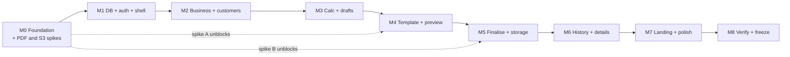

# 10 — Implementation Plan (single developer)

| | |
| --- | --- |
| Document | Execution plan · version 1.1 · 23 November 2026 |
| Team | **One developer** with Claude Code. No other developers are assumed anywhere in this plan |
| Statuses | **MUST COMPLETE** · **STRETCH** · **DEFERRED** |

## 1. Reality statement

- **The complete Revision 2 P0 (68–89 person-hours) is not achievable by one developer in the available time.** About 19 focused hours remain before the code freeze, so it would take roughly four times the available capacity.
- **The target is P0-Lite** (03 §2): one working invoice workflow from the landing page to re-downloading the same stored PDF, with real persistence, real calculations, real finalisation and real storage.
- **The P0-Lite estimate of 16.5–22 hours is aggressive and conditional.** It assumes that Claude Code speeds up routine work, that the M0 risk checks pass first time, and that no major defect appears. About 19 focused hours are available, so **finishing every P0-Lite item by the freeze is not guaranteed**. The checkpoints in §6 decide, at fixed times, what is reduced or deferred.
- Revision 2 remains the technical baseline. Its other P0 items (second template, GST demonstration mode, cloud deployment, plans and limits structures) are moved to STRETCH or DEFERRED, not dropped (03 §3–§4; 14 §4, C-03).
- **Quality floor (never weakened to meet the deadline):** calculation correctness, tenant isolation, finalisation integrity (unique numbering, idempotency, immutable snapshots) and persistence of data and PDFs (private storage with SHA-256 verification). If a feature cannot be finished safely, it is marked DEFERRED and left out of the demonstration. It is never faked or shipped in a weaker form.

## 2. Capacity and calendar

| Day (IST) | Working window | Breaks | Focused hours |
| --- | --- | --- | --- |
| Mon 23 Nov | 17:00–22:30 | 30 min | 5.0 |
| Tue 24 Nov | 09:00–21:00 | 15 min + 45 min + 45 min | 10.25 |
| Wed 25 Nov | 07:30–11:00 (code freeze at 11:00) | — | 3.5 |
| **Total before freeze** | | | **≈ 19 h** (rounded; 18.75 h scheduled below) |
| Wed 25 Nov | 11:00–12:30 | — | Backups and rehearsal (no coding) |

- **Estimate for all MUST milestones:** 16.5–22 h.
- **Low estimates:** about 2.5 h of slack, so some stretch work may be possible.
- **Mid estimates:** no slack at all.
- **High estimates:** about 3 h short. The reduction rules (§6) recover about 2.5 h.

**The estimate is aggressive and conditional.** The plan depends on the risk-first order and on applying the reduction rules at each checkpoint. Even then, completing the full P0-Lite within about 19 hours is a target, not a commitment.

**No overtime:** work stops at 22:30 on Monday and 21:00 on Tuesday. When a checkpoint slips, scope shrinks; hours do not grow. Fatigue causes the defects that break demonstrations (RK-10).

## 3. Milestones

Each milestone ends with its tests passing, a commit, and an updated PROGRESS.md (15 §5). The statuses are targets: a MUST COMPLETE item that a checkpoint shows cannot be finished safely moves to DEFERRED under §6 and is removed from the demonstration script.

| Milestone | Scope | Estimate | Status |
| --- | --- | --- | --- |
| M0 | Foundation and risk spikes | 1.5–2 h | MUST COMPLETE |
| M1 | Database, authentication, app shell | 2.5–3 h | MUST COMPLETE |
| M2 | Business profile and customers | 1.5–2 h | MUST COMPLETE |
| M3 | Calculation and drafts | 3–4 h | MUST COMPLETE |
| M4 | Template and watermarked preview | 2–2.5 h | MUST COMPLETE |
| M5 | Finalisation, storage, PDF | 2–3 h | MUST COMPLETE |
| M6 | History, details, dashboard | 1–1.5 h | MUST COMPLETE |
| M7 | Landing page and polish | 1.5–2 h | MUST COMPLETE (reducible by R2, R4, R5) |
| M8 | Verification and freeze | 1.5–2 h | MUST COMPLETE |
| **Total** | | **16.5–22 h** | |

### M0 — Foundation and risk spikes (1.5–2 h)

| Task | Deliverable |
| --- | --- |
| M0.1 | Repository layout (05 §4); CLAUDE.md, docs/, PROGRESS.md; `.gitignore`; `.env.example`, `.env.test.example`, `s3.example.json` with placeholders |
| M0.2 | `docker-compose.yml`: PostgreSQL 16 and SeaweedFS with identities, named volumes, ports bound to 127.0.0.1; the database init script creating `ps5`, `ps5_test` and both roles |
| M0.3 | Backend skeleton: settings that fail fast; app factory; JSON logs with request ID; problem+json handler; security headers; body size limit; E-01 `/healthz`; E-02 `/readyz` (database and storage checks) |
| M0.4 | **Risk spike A:** WeasyPrint renders a one-page PDF inside the container with the bundled Noto fonts and a visible ₹ (V-06). **Risk spike B, the SeaweedFS verification gate (05 §14.1):** the pinned image and configured command start (V-07); `init-dev-storage` creates the buckets and is safe to re-run (V-18); authenticated PUT and GET round-trip an object byte for byte (V-19); anonymous requests are refused (V-08) |
| M0.5 | Frontend skeleton: Vite + React 18 (pinned, V-03) + TypeScript, Tailwind tokens, router and query client; the dev proxy; the SPA served by FastAPI |
| M0.6 | Multi-stage Dockerfile; the image runs locally; `init-dev-storage` CLI |

- **Tests:** IT-HLT-01 (partial); FE-01 to FE-03 pass on the skeleton.
- **Exit:** `docker compose up` → `/healthz` 200, `/readyz` 200, the SPA loads, spike A passes and the SeaweedFS verification gate passes. **If spike A fails**, fix WeasyPrint before any feature work: the PDF is on the critical path. **If the SeaweedFS gate fails**, stop and ask the developer (15 §7); storage is on the critical path for M5.

### M1 — Database, authentication, app shell (2.5–3 h)

| Task | Deliverable |
| --- | --- |
| M1.1 | Alembic with `MIGRATION_DATABASE_URL`; migration `0001_identity` (06 §14) including `trg_audit_events_append_only` and grants |
| M1.2 | Argon2id hashing (V-13); session store (`token_hash`, idle and absolute expiry); cookie attributes (V-12) |
| M1.3 | E-03, E-04, E-05; the CSRF HMAC and Origin middleware; login throttling from `audit_events`; audit events |
| M1.4 | CLI `create-demo-account` (05 §8) |
| M1.5 | Frontend: login page (08 §11), route guard, app shell and navigation (L-03), sign-out, 404 page |

- **Tests:** UT-SEC-01, UT-SEC-02; IT-AUTH-01 to IT-AUTH-06; DB-01; DB-07.
- **Exit:** sign in and out in the browser; tests green. **CP1.**

### M2 — Business profile and customers (1.5–2 h)

| Task | Deliverable |
| --- | --- |
| M2.1 | Migration `0002_parties` |
| M2.2 | E-06 to E-12 with validation (09 §4), ETags and organization scoping (404) |
| M2.3 | Frontend: business profile (08 §13); customer list, search, create and edit (08 §14) |

- **Tests:** IT-BIZ-01 to IT-BIZ-03; IT-CUS-01, IT-CUS-02; IT-TEN-01 (business and customer endpoints).
- **Exit:** profile and customers persist across restarts.

### M3 — Calculation and drafts (3–4 h)

| Task | Deliverable |
| --- | --- |
| M3.1 | `calc` module, `calc-1.0.0` (09 §3), with fixtures F-01 to F-14 |
| M3.2 | Migration `0003_documents` (templates with the `classic@1` row, number series, documents, lines, guards) |
| M3.3 | E-13, E-14, E-15, E-17, E-18, E-19 |
| M3.4 | Frontend editor (08 §15) without Preview and Finalise: customer picker, lines, discounts, live server totals, save, delete, unsaved-changes guard |

- **Tests:** UT-CALC-01 to UT-CALC-09; IT-DOC-01 to IT-DOC-03; DB-02; DB-03 (draft rules); IT-TEN-01 (document endpoints).
- **Exit:** DC-07 to DC-10 pass manually. **CP2** comes in the middle of this milestone.

### M4 — Template and watermarked preview (2–2.5 h)

| Task | Deliverable |
| --- | --- |
| M4.1 | `classic@1` template (08 §20): Jinja2 environment (autoescape, StrictUndefined), formatting filters (09 §6) |
| M4.2 | Restricted URL fetcher; worker pool (2 processes, 20 s); bundled fonts |
| M4.3 | E-20 preview; the template registry hash plus `template-hash` CLI; `/readyz` template check |
| M4.4 | Frontend: preview dialog (08 §17); Templates page and the editor's Template select (08 §16) |

- **Tests:** UT-FMT-01; UT-SEC-03; IT-DOC-04; IT-PDF-05.
- **Exit:** DC-11 passes. **CP3.**

### M5 — Finalisation, storage, PDF (2–3 h)

| Task | Deliverable |
| --- | --- |
| M5.1 | Migration `0004_issuance` (snapshots, artifacts, stored files, idempotency keys, triggers, grants; V-14) |
| M5.2 | The finalisation service, exactly as in 09 §8 |
| M5.3 | Post-commit background render → S3 PUT → `stored_files` → artifact `ready` → audit |
| M5.4 | E-21, E-22 (hash-verified), E-23 (claim rule) |
| M5.5 | Frontend: finalise dialog with idempotency key and safe retries; PDF status polling; Download; Retry |

- **Tests:** UT-NUM-01, UT-NUM-02; UT-SNAP-01 to UT-SNAP-03; IT-FIN-01 to IT-FIN-07; IT-PDF-01 to IT-PDF-04; DB-04 to DB-06; DB-08; DB-09.
- **Exit:** DC-12 to DC-16 and DC-18 pass manually. **CP4.**

### M6 — History, details, dashboard (1–1.5 h)

| Task | Deliverable |
| --- | --- |
| M6.1 | E-16 with status filter, prefix search and cursor pagination |
| M6.2 | Frontend: history (08 §18), finalised details view (08 §19), dashboard (08 §12.3) |

- **Tests:** IT-DOC-05; IT-TEN-02.
- **Exit:** reopening and re-downloading gives byte-identical files (DC-15).

### M7 — Landing page and polish (1.5–2 h)

| Task | Deliverable |
| --- | --- |
| M7.1 | Landing page (08 §10.1) with the three-beat animation (08 §10.2) and reduced-motion support; ENTER THE SYSTEM |
| M7.2 | Polish pass: consistent loading, empty, error and success states; focus handling; responsive layouts at 360, 768 and 1280 px; copy review against 03 §8; CSP check (V-15) |

- **Tests:** FE-01 to FE-04; DC-02; DC-20.

### M8 — Verification and freeze (1.5–2 h)

| Task | Deliverable |
| --- | --- |
| M8.1 | Full automated run (11 §2). Fix defects only, never add features |
| M8.2 | Clean rebuild of the image; fresh volumes; migrate; create the demonstration account; enter the demonstration data set (11 §5) |
| M8.3 | Run DC-01 to DC-20 on the demonstration machine; record the results in PROGRESS.md |
| M8.4 | Freeze: tag `v0.1.0-demo`; `docker save` the image; `pg_dump` plus a copy of the SeaweedFS volume; export sample PDFs; record the backup screen capture; list known limitations |

- **Exit:** every DC check passes, or a failing check is removed from the live script and listed as deferred. **CP5.**

## 4. Dependencies and critical path

- **Critical path:** M0 → M1 → M2 → M3 → M4 → M5 → M6 → M8. With one developer, every milestone is sequential.
- **Reorderable:** M7 (landing) is the only milestone that could move earlier, for example to fill a waiting gap. It is scheduled late because it is not needed to prove the workflow.
- **Highest-risk items first:** WeasyPrint in Docker and S3 authentication (M0 spikes); finalisation concurrency (M5, protected by IT-FIN-04).

## 5. Feature status and stretch rules

| Status | Features |
| --- | --- |
| **MUST COMPLETE** | L-01 to L-16 (03 §2) |
| **STRETCH** | S-01 second template · S-02 cloud deployment (90 min time-box) · S-03 Playwright · S-04 full landing storyboard · S-05 amount in words |
| **DEFERRED** | P1-01 to P1-16 and P2-01 to P2-07 (03 §4–§5) |

Excluded features (03 §6) are not part of any plan.

**MUST COMPLETE** means required for the full P0-Lite and built first. It is not a guarantee of completion by the freeze: §6 governs what happens when time runs short.

**Stretch start conditions:**

1. CP4 was met on time.
2. M6 and M7 are complete before 09:45 on Wednesday.
3. At least 60 minutes remain before the freeze after stretch work, kept for M8.

Order if time allows: S-05 (about 45 min) → S-01 (about 1 h) → S-04 (about 45 min) → S-03 (about 1 h) → S-02 (90-minute time-box, only if evaluators need a URL, Q-14). **At mid estimates, expect no stretch work.**

## 6. Checkpoints and scope reduction

**How checkpoint decisions work:**

1. At each checkpoint, the developer compares the actual state with the target in §6.1.
2. If the target is missed, the listed reduction rules are applied immediately, recorded in PROGRESS.md with the time, and the remaining work is re-planned within the same working hours.
3. Working hours are never extended (§2).
4. Reductions only remove polish, convenience or scope. They never weaken the quality floor (§1).
5. Anything still unfinished at CP5 is DEFERRED and removed from the live script. The demonstration then ends at the last workflow stage that passes its DC checks, and the remaining stages are presented as deferred work, not shown.

### 6.1 Checkpoints

| Checkpoint | Time (IST) | Target state | If missed |
| --- | --- | --- | --- |
| CP1 | Mon 22:30 | M0 and M1 done: sign-in works; UT-SEC and IT-AUTH green | Stop for the night. Finish M1 first thing Tuesday. Apply R5 |
| CP2 | Tue 13:00 | M2 done; UT-CALC green; draft API passing IT-DOC-01 to IT-DOC-03 | More than 30 min late: apply R3 and R5 |
| CP3 | Tue 17:30 | Editor with live totals working; watermarked preview passes DC-11 | Apply R2 and R4 |
| CP4 | Tue 21:00 | Finalise → stored PDF → download works; IT-FIN and IT-PDF green; DC-12 to DC-14 pass | Apply R6. Wednesday morning = finish M5 and M6, then a minimal M7 (three-beat landing, 45 min) and M8 (1 h). No stretch work |
| CP5 | Wed 11:00 | Code freeze. DC-01 to DC-20 results recorded | Failing checks are removed from the live script and recorded as deferred. After 11:00, only a reviewed fix for a demonstration-blocking defect, followed by a full DC re-run |

### 6.2 Scheduled calendar (targets)

| When (IST) | Work |
| --- | --- |
| Mon 17:00–18:45 | M0 |
| Mon 18:45–19:15 | Break |
| Mon 19:15–22:30 | M1 → **CP1** |
| Tue 09:00–10:45 | M2 |
| Tue 10:45–11:00 | Break |
| Tue 11:00–13:00 | M3 part 1: calc + tests, migration 0003, draft API → **CP2** |
| Tue 13:00–13:45 | Lunch |
| Tue 13:45–15:15 | M3 part 2: editor UI |
| Tue 15:15–17:15 | M4 |
| Tue 17:15–17:30 | Buffer → **CP3** |
| Tue 17:30–18:15 | Dinner |
| Tue 18:15–20:45 | M5 |
| Tue 20:45–21:00 | Commit, PROGRESS.md, review → **CP4** |
| Wed 07:30–08:45 | M6 |
| Wed 08:45–10:00 | M7 |
| Wed 10:00–11:00 | M8 (tests, clean rebuild, DC run, fixes) → **CP5: freeze** |
| Wed 11:00–11:45 | Backups (§7) and remaining DC checks, with no code changes |
| Wed 11:45–12:30 | Rehearsal of the demonstration script (11 §7) |

M7 (1.25 h) and M8 (1 h before the freeze, plus 45 minutes of checks after it) are scheduled **below** their estimates. That is only workable because every earlier milestone runs its tests as it goes, and because R2, R4 and R5 are likely to be needed. Any overrun earlier in the plan triggers the reduction rules below rather than eating into M8.

### 6.3 Reduction rules

Each applied rule is recorded in PROGRESS.md with the time. The live script (11 §7) is then updated to match.

| Rule | Reduction | Saves (approx.) | Acceptance impact |
| --- | --- | --- | --- |
| R1 | Stretch freeze: no S-xx work until the §5 conditions hold | — | None (always on) |
| R2 | Landing keeps the hero, three-beat animation and value points, but drops the workflow strip and the "How it works" link. Dashboard shows quick actions and recent invoices only | 0.5 h | L-01 and L-13 still met |
| R3 | History search by number prefix only (the customer-name search is deferred); customer search unchanged | 0.5 h | FR-31 partially deferred; recorded |
| R4 | Responsive verification at 360 px and 1280 px only (the 768 px pass is skipped) | 0.25 h | FE-04 reduced; recorded |
| R5 | Editor conveniences: no quick-create customer dialog (use the Customers page); `beforeunload` guard only, without the in-app route blocker | 0.5 h | L-06 condition 7 partially met; recorded |
| R6 | Integration tests outside the never-cut suites become manual checks from the DC list | 0.75 h | Coverage reduced; never-cut suites stay automated |

**Never weakened** (if unfinished, deferred rather than weakened or faked):

- server-side `Decimal` calculation and UT-CALC;
- validation;
- atomic finalisation, numbering, idempotency and their tests (UT-NUM, IT-FIN);
- snapshots and immutability triggers (UT-SNAP, DB-03 to DB-07);
- private storage with SHA-256 verification (IT-PDF-01, IT-PDF-02);
- tenant scoping and IT-TEN;
- secure sessions, CSRF and IT-AUTH;
- the SPECIMEN text;
- persistence across restarts;
- honest labelling.

## 7. Fallback strategy

1. **Primary:** live demonstration on the presenter's laptop. Local Docker stack, no internet needed, Chrome desktop.
2. **Backup machine:** the same image (`docker save` / `docker load`), a restored `pg_dump` and SeaweedFS volume copy, and the same `.env`. Tested between 11:00 and 11:45 on Wednesday.
3. **Prepared state:** one finalised invoice with a ready PDF already in history. If a live step fails, the presenter opens it and explains the failure honestly. A PDF failure can be shown on purpose through the Retry flow (DC-18), because retrying is a real feature.
4. **Screen recording:** a capture of the full E2E-01 run, made after the freeze and labelled "Recorded on 25 Nov 2026 from the frozen build". It is used only if both machines fail, and the presenter says it is a recording.
5. **Exported PDFs:** a preview and a final PDF with its printed SHA-256, for discussion.
6. **Never:** mock screens, hard-coded data, or presenting a deferred feature as working.

## 8. Deployment milestones

| ID | Deployment | Status | Prerequisites | Exit criteria |
| --- | --- | --- | --- | --- |
| D-1 | Local Docker runtime on the presenter laptop and the backup machine | **MUST COMPLETE** (M0 → M8) | Docker; image built | DC-01 and DC-17 pass; image saved; backups restored on the backup machine |
| D-2 | Cloud staging on DigitalOcean BLR1 (05 §13.2) | **STRETCH** (S-02, 90-minute time-box) | All MUST items done; CP4 met; account access; V-10 and V-11 checked | HTTPS URL; `/readyz` 200; DC-01, DC-12, DC-14 and DC-17 pass remotely. Abandoned at 90 minutes if not healthy |
| D-3 | Production | **DEFERRED** (P1-14) | Q-04, Q-05, Q-11 answered; hardening complete | Defined in P1 planning |

If Heloavy requires a public URL (Q-14), D-2 becomes a scope change (14 §6). Another MUST item would then have to be deferred to make room; the quality floor still cannot be lowered.

## 9. Working with Claude Code

- **One milestone per session:** start a new Claude Code session for each milestone, so its context holds only what that milestone needs.
- **Session start prompt:** "Read CLAUDE.md, every file in docs/, and PROGRESS.md. Then implement milestone M{n} exactly as specified in docs/10 §3. Follow the workflow in docs/15 §3. Stop when M{n}'s exit criteria are met and report."
- **Session end:** Claude Code reports changed files, tests run with results, decisions made and open issues (15 §9), and updates PROGRESS.md. The developer reviews the diff, runs the app and commits with `M{n}: 
`.
- **Checkpoints:** the developer, not Claude Code, decides whether to apply a reduction rule. Claude Code may recommend one.

## 10. After the demonstration (DEFERRED work, sequencing proposal)

1. Collect Heloavy's answers to Q-01 to Q-12 (14 §2) and agree the P1 composition (A-13).
2. Hardening foundations and onboarding: P1-14 (row-level security, backups, monitoring), P1-01 (sign-up, verification, reset).
3. P1-10 cancellation and credit notes, which immutable invoices need before real use.
4. The official document types in Heloavy's order: P1-06 receipts, P1-07 payment requests, P1-09 bills (after Q-13).
5. P1-04 plans, usage limits and premium templates (after Q-08).
6. P1-05 GST, only after written CA approval (Q-03).
7. P1-03 logo; P1-02 roles; the enhancements P1-08, P1-11, P1-12, P1-13 and P1-15 as approved.

Effort for P1 is estimated after the scope is confirmed. No figures are given here, to avoid committing to unvalidated numbers.
