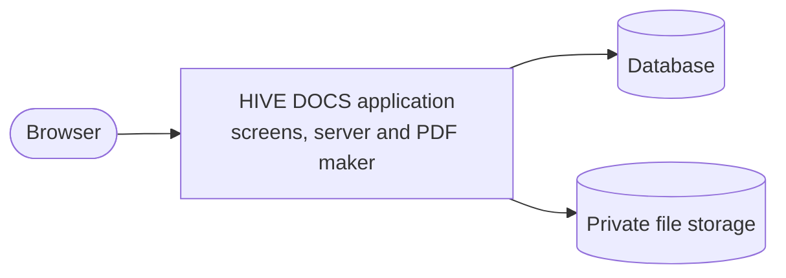

# 13 — Team Handoff (for HIVE Hub teammates)

| | |
| --- | --- |
| Document | Plain-language guide · version 1.1 · 23 November 2026 |
| For | Teammates preparing communication, slides and demonstration support |
| Rule | Describe only what is written here. If something is not listed as working, it is not working yet |

## 1. What problem we solve

Many small businesses make invoices in Word, Excel or as pictures sent on WhatsApp. That causes everyday problems:

- **Wrong totals:** discounts and sums are worked out by hand.
- **Messy numbering:** invoice numbers get skipped or repeated.
- **No reliable record:** an invoice can be edited after it was sent, so nobody can prove what the customer received.
- **Lost documents:** old invoices are scattered across folders, email and chat.
- **Inconsistent look:** every invoice looks a little different.

## 2. Who experiences the problem

Our working assumption is **owner-run service businesses in India with roughly 1–20 people**: freelancers, consultants, design and IT studios, small agencies. They send invoices to business clients and do not have accounting staff.

This is an assumption that Heloavy still needs to confirm (Q-02). We are **not** targeting retail shops that need a checkout counter, stock tracking or barcode scanners (Q-01).

## 3. Our proposed solution

**HIVE DOCS** is a working name that Heloavy still has to approve (Q-21). It is a web application where a business:

1. enters its details once;
2. adds its customers;
3. creates an invoice by adding line items;
4. lets the system calculate every amount exactly;
5. **finalises** the invoice, which gives it a unique number and locks it so it can no longer be changed;
6. gets a professional PDF that is stored safely;
7. can find and download that exact same PDF again later, for as long as it is retained (how long will follow the retention policy Heloavy approves and the law).

## 4. Core functionality in the 25 November demonstration

This is the planned demonstration. The schedule is aggressive and conditional: anything that does not pass its checks by the code freeze is left out of the live demonstration and described as deferred (10 §6).

| What you will see | What is really happening |
| --- | --- |
| A landing page with a short animation of an invoice being filled in, totalled and stamped "FINALISED" | A real page; the button leads into the real application |
| Signing in | A real password check (the password is stored as a secure Argon2id hash) and a real session |
| Business profile and customers | Saved in a real PostgreSQL database |
| Building an invoice with several lines, quantities, prices and discounts | Every total is calculated **on the server** with exact decimal maths, never by the browser |
| A PDF preview marked "DRAFT — NOT ISSUED" | A real PDF generated on the server |
| Finalising | One database transaction: next invoice number, today's date, a frozen copy of everything, an audit record |
| Downloading the PDF | The real stored file, checked against its digital fingerprint (SHA-256) before it is sent |
| The history page | Real records you can filter, search, reopen and download again |

Every PDF carries the sentence **"SPECIMEN — demonstration document, not a tax invoice."** because GST rules need a chartered accountant's approval first.

## 5. User workflow

## 6. Technology stack (in plain words)

| Part | Technology | What it does |
| --- | --- | --- |
| Screens | React 18 with TypeScript, Vite, Tailwind CSS, Radix UI | The pages you see and click |
| Server | Python 3.12 with FastAPI | Checks passwords, validates input, calculates money, issues invoices |
| Database | PostgreSQL 16 | Stores businesses, customers, invoices and the audit history |
| Money maths | Python `Decimal` | Exact arithmetic: no rounding surprises such as 1.005 becoming 1.00 |
| PDF creation | Jinja2 + WeasyPrint | Turns invoice data into a PDF on the server |
| File storage | Private S3-compatible storage (SeaweedFS on the laptop) | Keeps every issued PDF safely |
| Packaging | Docker | Runs the whole system on one laptop, offline |

## 7. Architecture summary

It is **one application**, a "modular monolith": one program with clearly separated parts, not many small services. It talks to a database and a private file store.

Key safety ideas:

- **Each organization sees only its own data.**
- **The server is the only one allowed to calculate money.**
- **Finalised invoices cannot be changed** while they are retained.
- **Every stored PDF has a fingerprint** that is checked before every download.

## 8. What the demonstration will prove

1. The complete invoice workflow works end to end with real data that survives a restart.
2. Calculations are exact (₹1,800.00 + ₹900.00 = ₹2,700.00 from the fixture lines; 1.005 × ₹1.00 = ₹1.01).
3. Numbers are unique, even if someone double-clicks Finalise.
4. An issued invoice cannot be changed, and its PDF downloads identically every time.
5. If PDF generation fails, it can be retried without creating a new invoice number.
6. One organization cannot see another organization's documents.

## 9. What is not yet implemented

These are planned or under discussion. They do **not** work in the demonstration:

- self-service sign-up, password reset, multiple users and roles;
- logo upload;
- subscription plans, usage limits and premium templates;
- GST calculations of any kind (waiting for a chartered accountant);
- receipts, payment requests, payment recording and bills;
- cancelling an invoice or issuing credit notes;
- salary slips;
- exports, multiple businesses, recurring invoices, email or WhatsApp sending;
- cloud hosting (the demonstration runs on a laptop; a cloud version is only a stretch goal).

**Not planned at all:** inventory, barcode scanning, retail checkout, AI features, a drag-and-drop template designer, complex analytics.

## 10. Future scope

- **P1 (first usable client release):** sign-up and accounts, receipts, payment requests, bills (once defined), plans and limits with premium templates, cancellation and credit notes, logos, production-grade security. GST comes only after a chartered accountant approves the rules.
- **P2 (commercial expansion):** salary slips (with extra privacy protection), multiple businesses, recurring invoices, sending documents, simple business reports, e-invoicing for larger businesses.

The exact order depends on Heloavy's answers (14).

## 11. Honest project limitations

- **One developer and about two days.** Only a small part of the full product is built; the full Revision 2 P0 plan would take 68–89 hours. Even the P0-Lite estimate (16.5–22 hours against about 19 available) is aggressive and conditional, so parts of it may be deferred at the checkpoints. Correctness, data isolation, finalisation integrity and PDF storage are never weakened to save time.
- **Demonstration build:** synthetic data only, one business, one owner account, one invoice template.
- **Not a tax invoice:** no GST, and nothing is certified or "compliant".
- **Runs on a laptop:** not yet on the internet.
- **Not ready for real customer data** until production security and privacy work is done (12 §13–§14).
- **Assumptions not yet validated:** the customer segment and the problems listed in §1 are research assumptions that pilot users still need to confirm.

## 12. How to talk about the project

| Say | Do not say |
| --- | --- |
| "A working demonstration of the invoice workflow, built to production standards for correctness and data safety." | "A complete POS system." |
| "The PDF says SPECIMEN because GST needs a chartered accountant's approval first." | "GST-compliant", "tax-ready", "certified" |
| "Receipts, payment requests and salary slips are planned after the demonstration." | That any deferred feature already works |
| "Built by one developer with an AI coding assistant." | "AI-powered" (the product has no AI features) |
| "HIVE DOCS is our working name, pending Heloavy's approval." | That the name is final |
| "Data stays on our laptop for the demonstration; hosting is a decision for Heloavy." | That it is live in the cloud |
| "Issued invoices can't be changed while they're kept; how long they're kept will follow Heloavy's policy and the law." | "Your documents are stored forever." |

**Likely questions and honest answers:**

- *Is this a POS?* It covers the billing documents of the problem statement. Retail checkout hardware is outside the current scope, and we are asking Heloavy what "POS" should mean (Q-01).
- *Can I use it for GST invoices?* Not yet. GST needs rules approved by a chartered accountant (Q-03).
- *Where is the data stored?* Locally, in PostgreSQL and private file storage on the demonstration laptop. A cloud setup is designed but not deployed.
- *What happens if the PDF fails?* The invoice keeps its number, and the PDF can be regenerated with Retry.
- *Can an issued invoice be edited?* No. Corrections will use credit notes in a later version.
- *How long are documents kept?* For the demonstration, until Heloavy's evaluation is over. In production, for the period set by the retention policy Heloavy approves and the law requires (Q-18). Issued documents stay unchanged throughout.

## 13. How teammates can help

| Task | Owner | Notes |
| --- | --- | --- |
| Slides and talking points within §12 | Teammates | No screenshots of features that are not built; no fake testimonials or statistics |
| Ask Heloavy the blocking questions: Q-14 (local demonstration acceptable?) and Q-15 (time, format, screen, internet) | Team lead | Answers change the demonstration set-up |
| Review screen text for clarity and honesty (03 §8) | Teammates | On Tuesday evening or Wednesday morning |
| Test on a phone-sized screen on Wednesday morning | One teammate | Report problems; do not ask for new features |
| Demonstration day: timekeeper and backup operator | Two teammates | The backup operator knows the fallback steps (10 §7) and the screen recording |
| After the demonstration: record Heloavy's answers to Q-01 to Q-12 | Team lead | Feeds the P1 plan |

## 14. Glossary

| Term | Meaning |
| --- | --- |
| Draft | An invoice that can still be edited; it has no number yet |
| Finalise | Issue the invoice: it gets a number and the date and becomes locked |
| Snapshot | A frozen copy of all invoice details taken at finalisation |
| SHA-256 | A digital fingerprint; if a file changes by even one byte, the fingerprint changes |
| Tenant / organization | A customer account of HIVE DOCS; each sees only its own data |
| Idempotency | Doing the same request twice has the same effect as doing it once (no double invoices) |
| SPECIMEN | The label showing a PDF is a demonstration document, not a tax invoice |
| P0-Lite | What one developer builds for 25 November |
| P1, P2 | Later phases of the product |
| CA | Chartered accountant, needed to approve tax rules |
