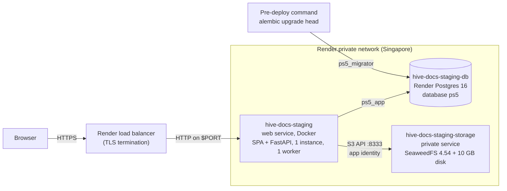

# HIVE DOCS on Render — staging deployment guide

> **Status (24 Nov 2026): prepared, not deployed.** No Render resource has been created, and nothing in this guide has run on Render. The configuration was checked against Render's published Blueprint schema and documentation (fetched 24 Nov 2026), and its behaviour was rehearsed in the cloud development container ([§13](#13-evidence)). Every Render-specific step below is still **unverified on Render**.
>
> **Scope.** This is a *staging* environment for evaluation, with synthetic data only (docs/11 §5, docs/12 §16). It is not production: P1-14 hardening (backups with tested restores, monitoring, row-level security, MFA, document encryption, DPDP review) is still deferred. It replaces the DigitalOcean cloud reference of docs/05 §13.2 for staging, at the developer's request, and keeps the approved stack: React, FastAPI, PostgreSQL 16 and SeaweedFS 4.54 in one modular-monolith image.

## Contents

1. [What gets created](#1-what-gets-created)
2. [Security model](#2-security-model)
3. [Before you start](#3-before-you-start)
4. [Generate the secrets](#4-generate-the-secrets)
5. [First deployment, step by step](#5-first-deployment-step-by-step)
6. [Environment reference](#6-environment-reference)
7. [Migrations](#7-migrations)
8. [Deploying updates](#8-deploying-updates)
9. [Staging verification](#9-staging-verification)
10. [Backups and restore](#10-backups-and-restore)
11. [Rollback and credential rotation](#11-rollback-and-credential-rotation)
12. [Costs and teardown](#12-costs-and-teardown)
13. [Evidence](#13-evidence)
14. [Known limitations and open items](#14-known-limitations-and-open-items)

## 1. What gets created

`render.yaml` at the repository root is a Render Blueprint. Applying it creates three resources, all in the **Singapore** region:



| Resource | Blueprint name | Type and plan | Notes |
| --- | --- | --- | --- |
| Database | `hive-docs-staging-db` | Render Postgres, PostgreSQL **16**, plan `0.1c-256mb`, 5 GB disk | Database `ps5` (Render may add a suffix), initial user `ps5_migrator`, external access closed (`ipAllowList: []`) |
| Object storage | `hive-docs-staging-storage` | Private service (`pserv`), plan `0.5c-512mb`, 10 GB persistent disk at `/data` | Built from `deploy/render/seaweedfs/Dockerfile` (SeaweedFS 4.54, the same digest as Compose). No public URL |
| Application | `hive-docs-staging` | Web service, Docker, plan `0.5c-512mb`, 1 instance | Built from the root `Dockerfile`; health check `/readyz`; pre-deploy migrations |

All three are **paid**: pre-deploy commands, persistent disks, private services and the shell are not available on Render's free instances, and free Postgres expires after 30 days with no backups. See [§12](#12-costs-and-teardown).

The web plan was sized from a measurement in the cloud container: the application used about 92 MiB idle and about 218 MiB at peak while rendering PDFs with its two render workers.

## 2. Security model

The local security boundaries (docs/04, docs/06 §11, docs/12) carry over unchanged.

**Database roles.**

| Role | Created by | Used by | Can do |
| --- | --- | --- | --- |
| `ps5_migrator` | Render, as the database's initial user (`user:` in the Blueprint) | The pre-deploy command only (`MIGRATION_DATABASE_URL`) | Owns the database and its objects; runs DDL |
| `ps5_app` | You, once, with `CREATE ROLE` ([§5.4](#54-create-the-restricted-application-role)) | The running server (`DATABASE_URL`) | Only the table privileges each migration grants, plus CONNECT and USAGE on `public` (migration `0005_app_role_privileges`). No DDL, no TRUNCATE, no UPDATE or DELETE on snapshots, files or audit events |

- Migration `0005_app_role_privileges` refuses to run when `ps5_app` is missing, is a superuser, has CREATEDB, CREATEROLE, REPLICATION or BYPASSRLS, or is a member of the migrating role.
- **Never create `ps5_app` with Render's "+ New default credential".** A Render-managed credential becomes the database's *default* user, and the Blueprint's `connectionString` reference (`MIGRATION_DATABASE_URL`) would switch to it on the next sync. Render does not manage roles made with `CREATE ROLE`, so they never replace the default user.
- Render runs the pre-deploy command with the web service's environment, so `MIGRATION_DATABASE_URL` is present in the running web service too. The server never reads it, but a compromise of the web process could. This is accepted for staging; for production, run migrations from a separate job or service (P1-14).

**Object storage.**

- The storage service is a Render *private service*: it has no `onrender.com` URL and cannot be reached from the internet.
- Inside the private network, only the S3 gateway listens beyond localhost:
  - port 8333 requires signed requests;
  - port 18333, its gRPC port, serves only SeaweedFS's IAM cache, and SeaweedFS 4.54 accepts those calls only from local callers.
- The master, volume and filer servers, whose HTTP APIs have no authentication, bind to 127.0.0.1. The Iceberg and Lance catalogs and the embedded IAM API are off, and buckets are never created automatically.
- Identities come from a Render **secret file** (`s3.json`), never from Git. It holds one identity, the application's, with `Read`, `Write` and `List` on `ps5-documents-staging` only. It cannot create or delete buckets, change versioning, ACLs or policies, or reach other buckets.
- Provisioning (creating the bucket and enabling versioning) uses `weed shell` inside the storage service, reached through the Render Dashboard shell. No S3 administrator key exists at runtime, so provisioning rights stay separate from the application's credentials. If you prefer an S3-API provisioning identity, add it to the secret file only for the operation (`Admin:ps5-documents-staging`, never global `Admin`), then remove it.
- **Private network scope.** On Render, every service in the same workspace and region shares the private network. Deploy staging in a workspace that holds only HIVE DOCS services, or use a project environment with private-network isolation (a Render Pro workspace feature).

**Application.**

- `APP_ENV=production` turns off the API docs UI and makes `/readyz` fail on any template-hash mismatch.
- The session cookie is always HttpOnly, `Secure` and SameSite=Lax; Render serves the site over HTTPS only.
- CSRF and Origin checks compare against `APP_ORIGIN` exactly.
- The image runs as uid 10001 with one uvicorn worker. Do not scale it beyond one instance: the rate limits and the render pool are per process.
- **Client IP.** `CLIENT_IP_HEADER` is left unset, because Render does not document which request header carries the client address (V-11). The server therefore sees Render's proxy address, and the per-IP sign-in throttle (5 failures in 15 minutes) counts every user together. This fails safe (sign-in is refused, never opened), but a few wrong passwords from anyone pause all sign-ins for 15 minutes.

**Secrets.** Nothing secret is in Git or in `render.yaml`:

- secrets are entered in the Render Dashboard (`sync: false`);
- `CSRF_SECRET` is generated by Render (`generateValue`);
- the migrator URL is referenced from the database (`fromDatabase`);
- `s3.json` is a secret file.

The root `.dockerignore` is an allowlist and the storage context ignores everything. Render copies secret files into the build context root, so they still cannot enter either image.

## 3. Before you start

- A Render workspace you control. Prefer a dedicated one ([§2](#2-security-model)), with a payment method, because the resources are paid.
- Render access to the GitHub repository, and a decision on which branch the Blueprint follows (for example `claude/busy-bell-14l7rh`, or `main` once merged).
- `psql` on your own machine (PostgreSQL 16 client) for the one-time role set-up.
- A password manager to hold the generated secrets. Never paste secrets into chat, issues, commits or screenshots.

## 4. Generate the secrets

Run these on your own machine. Each prints one value; store it in the password manager under the name shown.

```bash
python3 -c "import secrets; print(secrets.token_urlsafe(24))"   # S3 app access key id
```

```bash
python3 -c "import secrets; print(secrets.token_urlsafe(40))"   # S3 app secret key
```

```bash
python3 -c "import secrets; print(secrets.token_urlsafe(32))"   # ps5_app database password
```

`token_urlsafe` uses only letters, digits, `-` and `_`, so the values can go into URLs and JSON without escaping. You do not generate:
- `CSRF_SECRET`, which Render generates;
- the `ps5_migrator` password, which Render creates with the database.

## 5. First deployment, step by step

The order matters: the web service cannot become healthy until the database role, the bucket and its own settings exist. **Its first deploy is expected to fail. That is harmless:** each migration runs in its own transaction, and the first one stops at its first grant to the missing `ps5_app` role.

### 5.1 Apply the Blueprint

1. In the Render Dashboard: **New → Blueprint**, select the repository and the branch. Render reads `render.yaml`.
2. Render asks for the `sync: false` values of the web service:

   | Variable | Enter now |
   | --- | --- |
   | `S3_ACCESS_KEY_ID` | The S3 app access key id from [§4](#4-generate-the-secrets) |
   | `S3_SECRET_ACCESS_KEY` | The S3 app secret key from [§4](#4-generate-the-secrets) |
   | `DATABASE_URL` | Temporary placeholder `postgresql://pending@pending/ps5`; replaced in [§5.5](#55-finish-the-web-service-settings) |
   | `S3_ENDPOINT_URL` | Temporary placeholder `http://pending:8333`; replaced in [§5.5](#55-finish-the-web-service-settings) |

3. Apply. The expected first results are:
   - the database becomes *Available*;
   - the storage service fails to start until its secret file exists ([§5.2](#52-give-the-storage-service-its-identities));
   - the web service's deploy fails at the pre-deploy step because the role `ps5_app` does not exist yet.

### 5.2 Give the storage service its identities

1. Copy `deploy/render/seaweedfs/s3.example.json` to a file **outside the repository**. Replace the two placeholders with the S3 app access key id and secret key from [§4](#4-generate-the-secrets). Keep the actions exactly as they are.
2. On `hive-docs-staging-storage` → **Environment → Secret Files → + Add Secret File**, set the filename to `s3.json` and paste the contents. Save. Render redeploys the service and mounts the file at `/etc/secrets/s3.json`, readable by the SeaweedFS user (uid and gid 1000).
3. Delete your local copy.
4. When the service is *Live*, note its internal address from its page: **Connect → Internal**, for example `hive-docs-staging-storage-xxxx:8333`.

### 5.3 Create the bucket with versioning

On `hive-docs-staging-storage` → **Shell**, run:

```bash
printf 's3.bucket.create -name ps5-documents-staging\ns3.bucket.versioning -name ps5-documents-staging -status Enabled\ns3.bucket.versioning -name ps5-documents-staging\n' | weed shell -master=127.0.0.1:9333
```

Expected output: `created bucket ps5-documents-staging`, `Bucket ps5-documents-staging versioning set to Enabled` and `Versioning: Enabled`. The shell talks to the master on localhost, so this works only from inside the storage service. Running it again on an existing bucket is harmless.

### 5.4 Create the restricted application role

1. On `hive-docs-staging-db` → **Info → Networking**, temporarily add your own public IP address (`/32`) to the IP allow list.
2. Connect with the **PSQL Command** from the database's Info page. It uses the external URL and the `ps5_migrator` user, and Render requires TLS for external connections.
3. In `psql`:

   ```sql
   CREATE ROLE ps5_app LOGIN;
   \password ps5_app
   ```

   `\password` asks twice for the `ps5_app` password from [§4](#4-generate-the-secrets). It sends only a SCRAM hash to the server, so the password never appears in server logs. Then check the role:

   ```sql
   SELECT rolsuper, rolcreatedb, rolcreaterole, rolreplication, rolbypassrls FROM pg_roles WHERE rolname = 'ps5_app';
   ```

   All five columns must be `f`.
4. Remove your IP from the allow list. The next Blueprint sync would reset it to `[]` anyway.

If your role cannot run `CREATE ROLE` (Render's documentation says roles made with `CREATE USER` are supported, but this has not been tried), stop and contact Render support. Do not fall back to a Render default credential ([§2](#2-security-model)).

### 5.5 Finish the web service settings

On `hive-docs-staging` → **Environment**, replace the two placeholders:

| Variable | Value |
| --- | --- |
| `DATABASE_URL` | `postgresql://ps5_app:<ps5_app password>@<internal host>:5432/<database>?sslmode=require`. Copy `<internal host>` and `<database>` from the database's **Internal Database URL**; the database name may carry a suffix. `sslmode=require` encrypts the connection on the private network |
| `S3_ENDPOINT_URL` | `http://<storage internal address>`, for example `http://hive-docs-staging-storage-xxxx:8333` ([§5.2](#52-give-the-storage-service-its-identities)) |

Check that `APP_ORIGIN` shows the service's `https://….onrender.com` URL. It is referenced from Render's `RENDER_EXTERNAL_URL`. If it is empty, set it by hand; it must match the browser origin exactly, with no trailing slash.

Save, then **Manual Deploy → Deploy latest commit**:
1. the pre-deploy command runs migrations `0001` to `0005`;
2. the new instance starts on `$PORT`;
3. Render routes traffic only after `/readyz` returns 200. Render cancels the deploy if that has not happened within 15 minutes.

### 5.6 Check the storage permissions and create the accounts

On `hive-docs-staging` → **Shell**:

```bash
cd /app/backend && python -m app.cli check-storage
```

Expected: the bucket is reachable, `versioning: Enabled`, both administrative probes are `refused (AccessDenied)`, then `check-storage: OK`. Any `ALLOWED` means the app identity can administer the bucket: fix `s3.json` before going further.

Then create the demonstration accounts. There is no sign-up (docs/02 FR-06). The command asks for the password at a hidden prompt:

```bash
cd /app/backend && python -m app.cli create-demo-account --email owner@demo.invalid --name "Demo Owner" --org "Demo Studio"
```

```bash
cd /app/backend && python -m app.cli create-demo-account --email auditor@demo.invalid --name "Isolation Auditor" --org "Isolation Check Org"
```

Enter the demonstration data (docs/11 §5) in the browser, or from your own machine with the helper. The helper uses the public API and asks for the password:

```bash
cd backend && uv run python scripts/enter_demo_data.py --base-url https://<your service>.onrender.com
```

## 6. Environment reference

Web service `hive-docs-staging`:

| Variable | Value on staging | Source | Notes |
| --- | --- | --- | --- |
| `APP_ENV` | `production` | Blueprint value | Docs UI off; template hashes enforced |
| `APP_ORIGIN` | `https://<service>.onrender.com` | `fromService` → `RENDER_EXTERNAL_URL` | Exact origin: CSRF, Origin checks, `Secure` cookies. Change it if you add a custom domain |
| `DATABASE_URL` | `postgresql://ps5_app:…@<internal host>:5432/<db>?sslmode=require` | Dashboard (`sync: false`) | Restricted runtime role |
| `MIGRATION_DATABASE_URL` | Render's internal connection string (`ps5_migrator`) | `fromDatabase` → `connectionString` | Used by the pre-deploy migrations only |
| `S3_ENDPOINT_URL` | `http://<storage internal hostname>:8333` | Dashboard (`sync: false`) | Private network only; never a public URL |
| `S3_BUCKET` | `ps5-documents-staging` | Blueprint value | Must match `s3.json` and the provisioned bucket |
| `S3_REGION` | `us-east-1` | Blueprint value | SeaweedFS ignores it; the signing region must be consistent |
| `S3_ADDRESSING_STYLE` | `path` | Blueprint value | SeaweedFS |
| `S3_ACCESS_KEY_ID`, `S3_SECRET_ACCESS_KEY` | The app identity's keys | Dashboard (`sync: false`) | The same pair as in `s3.json` |
| `CSRF_SECRET` | 256 random bits, base64 | `generateValue: true` | Render generates it once and keeps it |
| `RENDER_WORKERS`, `RENDER_TIMEOUT_S`, `LOG_LEVEL` | `2`, `20`, `INFO` | Blueprint values | docs/05 §9 |
| `PORT` | Set by Render (`10000` by default) | Render | The image listens on `$PORT`, else 8000 |
| `CLIENT_IP_HEADER` | Unset | — | See [§2](#2-security-model) and [§14](#14-known-limitations-and-open-items) |

**Database URL formats.** Both URL variables accept `postgresql://`, `postgres://` (any letter case) and `postgresql+psycopg://`. The settings rewrite only the scheme to `postgresql+psycopg://` (psycopg 3). User, password, host, port, database and query parameters such as `sslmode` are kept byte for byte. Any other driver (`postgresql+psycopg2://`, `postgresql+asyncpg://`, …) or another database is refused, and the error names the variable but never prints its value.

Storage service `hive-docs-staging-storage`: no environment variables. It has one secret file, `s3.json` ([§5.2](#52-give-the-storage-service-its-identities)).

## 7. Migrations

- The image contains `alembic.ini` and `alembic/` (migrations `0001` to `0005`). The pre-deploy command is `alembic -c /app/backend/alembic.ini upgrade head`. Render runs it from the built image on separate compute before each deploy. It works from any working directory, which was tested in the image with working directory `/`.
- If a migration fails, Render fails the deploy and the previous version keeps running. Each migration runs in its own transaction.
- `0005_app_role_privileges` grants CONNECT on `current_database()` and USAGE on `public`, so it works on `ps5`, `ps5_test` and a suffixed name. It repeats `REVOKE CREATE ON SCHEMA public FROM PUBLIC`, and checks that `ps5_app` is restricted.
- It leaves PUBLIC's default CONNECT and TEMPORARY on the database and USAGE on `public` in place, because Render's own tooling may rely on them. The local init script revokes them, so `ps5_app` can create temporary (session-only) tables on Render but not locally.
- Its downgrade does nothing. **Never run `alembic downgrade` on staging:** the downgrades of `0001` to `0004` drop tables (docs/06 §14 rule 5).
- Migrations are forward-only from here: a change to the schema is a new migration, reviewed by hand (docs/06 §14).

## 8. Deploying updates

- `autoDeployTrigger: "off"`: pushes to the branch do not deploy. Deploy with **Manual Deploy → Deploy latest commit** on the web service (and on the storage service when `deploy/render/seaweedfs/` changes).
- Changes to `render.yaml` apply on a **Blueprint sync**. Render keeps environment variables that the file omits. `sync: false` values are prompted only when the Blueprint is first created; after that you set them on the service's Environment page.
- The storage service has a disk, so Render stops the old instance before starting the new one: object storage is unavailable for a few seconds on every storage deploy, and the web service's `/readyz` reports `storage: error` meanwhile. Deploy storage only when needed and out of hours.
- Web deploys are zero-downtime: the old instance serves until the new one passes `/readyz`.

## 9. Staging verification

Run after the first deploy and after each change to infrastructure. Record the results in `PROGRESS.md`, labelled "Render staging".

| Check | How | Expected |
| --- | --- | --- |
| Liveness and readiness | `curl -i https://<service>.onrender.com/healthz` and `/readyz` | 200; `readyz` shows `database`, `storage` and `templates` all `ok` |
| Docs UI is off | `curl -i https://<service>.onrender.com/docs` | 404 |
| Storage permissions | `check-storage` in the web shell ([§5.6](#56-check-the-storage-permissions-and-create-the-accounts)) | `check-storage: OK` |
| Storage is private | The storage service page | No public URL; only the internal address |
| Database is closed | `psql` with the external URL after removing your IP | Connection refused by the allow list |
| Migrations | `SELECT version_num FROM alembic_version;` (as `ps5_migrator`) | `0005_app_role_privileges` |
| Cookie and headers | Sign in; inspect the cookie and response headers in DevTools | `ps5_session` HttpOnly, Secure, SameSite=Lax; CSP and security headers as locally |
| Product checks | DC-02 to DC-16 and DC-19 from docs/11 §3, run against the staging URL | As specified. DC-01, DC-17 and DC-18 need Docker Compose and are replaced by this table |
| Persistence | Download a final PDF; deploy the storage service; download again | Same SHA-256 |

## 10. Backups and restore

**Postgres** (Render, paid plans only; Render's documentation):
- *Point-in-time recovery*: the past 3 days on a Hobby workspace, 7 days on Pro. A recovery creates a **new** database instance, which keeps every role, including `ps5_app`.
- To switch to it:
  1. point `DATABASE_URL` at the new instance's internal host;
  2. point `MIGRATION_DATABASE_URL` at it, by renaming the `fromDatabase` reference in `render.yaml` or setting the value by hand;
  3. redeploy the web service.
- *Logical backups*: create an export on the database's **Recovery** page. Render keeps exports for 7 days; download the ones you need. Exports do not contain roles: after restoring an export into a new instance, repeat [§5.4](#54-create-the-restricted-application-role) before migrating.

**Object storage** (Render disk snapshots):
- Render snapshots the disk once every 24 hours and keeps each snapshot for 7 days. A restore replaces the whole disk.
- SeaweedFS keeps its metadata in LevelDB under `/data`. A snapshot of a running service is crash-consistent, not quiesced. Render warns against restoring snapshots of database disks, so treat a restore as a last resort and run `check-storage` and a PDF download afterwards.
- Stored PDFs are only ever added, never changed.
  - Restoring the **database** to an earlier time than the storage is safe: newer objects are simply unused.
  - Restoring **storage** to an earlier time than the database loses newer PDFs. Their downloads then fail the integrity check (`integrity_check_failed`, by design), and those invoices need a decision.
- For staging with synthetic data, the snapshots plus Postgres point-in-time recovery are enough. Production backups belong to P1-14.

## 11. Rollback and credential rotation

**Rolling back code.** On the web service's **Deploys** page, choose an earlier successful deploy → **Rollback**. Render notes the following:
- a rollback reuses that deploy's build **and its environment variables**, so after rotating a credential, roll forward instead;
- a rollback disables automatic deploys (already off here);
- disks are never rolled back.

Database migrations are not reversed. Two cases follow from that:
- rolling back to a build that still contains the database's current migration is safe;
- if Render runs the pre-deploy command during a rollback (not documented), a build that predates the current migration fails there (Alembic cannot find the newer revision), and the current version keeps running. In that case revert the commit and deploy forward.

**Rotating credentials.**

| Credential | How |
| --- | --- |
| `ps5_app` password | `\password ps5_app` in `psql` ([§5.4](#54-create-the-restricted-application-role)), then update `DATABASE_URL` and deploy. Connections opened by the old instance keep working until it is replaced |
| S3 app keys | Add a second credential to the `hive-docs-app` identity in `s3.json` (SeaweedFS accepts several), deploy storage, update the two web variables, deploy the web service, then remove the old credential |
| `ps5_migrator` | Render's credential rotation (database **Info → Credentials**) creates a new *default* user. Sync the Blueprint so `MIGRATION_DATABASE_URL` follows, then delete the old user. **Unverified:** whether the new user can run migrations on objects the old user owns. Test this in a scratch database before relying on it |
| `CSRF_SECRET` | Set a new random value on the Environment page and deploy. Sessions stay valid, but pages open at the time must be reloaded to get a new CSRF token; the sign-in throttle counters restart, because they are keyed with the same secret |

## 12. Costs and teardown

The Blueprint creates only paid resources:
- Postgres `0.1c-256mb` with 5 GB;
- a `0.5c-512mb` private service with a 10 GB disk;
- a `0.5c-512mb` web service.

Builds and pre-deploy commands also use pipeline minutes. Check current prices on Render's pricing page before applying. Nothing has been created yet.

To tear staging down after the evaluation (docs/12 §16):
1. delete the web service;
2. delete the storage service, which deletes its disk and every stored PDF;
3. delete the database after taking any export you must keep;
4. delete the Blueprint instance.

## 13. Evidence

All of the following ran in the **cloud development container** (Linux) on 24 Nov 2026, **not on Render**.

| What | Result |
| --- | --- |
| `render.yaml` against Render's JSON schema (`render.com/schema/render.yaml.json`) | 0 errors. A control file with an unknown field and an invalid region was rejected |
| Application image built from a sandbox-derived copy of the root `Dockerfile` (only the proxy and CA mounts of the three download steps differ; the committed file cannot reach the network from build containers here) | Contains `alembic.ini`, `alembic/env.py` and migrations `0001`–`0005`; no `.env`, `s3.json`, tests or PDFs; user 10001 |
| That image with `PORT=10000`, `APP_ENV=production` and Render-style `postgresql://` URLs, on the Compose database and storage | `/healthz` 200; `/readyz` 200 (`database`, `storage` and `templates` all `ok`); `/docs` 404; uvicorn is the main process with one worker; `docker stop` exited 0 after a graceful shutdown |
| The pre-deploy command in that image, with working directory `/` | `alembic -c /app/backend/alembic.ini upgrade head` succeeded |
| A fresh database owned by `ps5_migrator`, with PUBLIC's CONNECT and USAGE revoked and nothing granted to `ps5_app` (stricter than Render's defaults), migrated through a plain `postgresql://` URL | Before: `ps5_app` refused. After `0001`–`0005`: `ps5_app` connects and reads tables, cannot create in `public`; no password in the output. Scratch database dropped afterwards |
| Storage image from `deploy/render/seaweedfs/` with a fake `s3.json` placed in its build context | The file did not enter the image. Listeners beyond localhost: 8333 and 18333 only. From a peer container, 9333, 19333, 8080, 18080, 8888, 18888, 8181 and 9101 were closed |
| Bucket provisioning with `weed shell` inside that container | Bucket created and versioning `Enabled`, without any S3 administrator key |
| App identity (Read, Write, List) against that bucket | `HeadBucket`, PUT and GET (byte-identical) allowed. `PutBucketVersioning`, `PutBucketAcl`, `DeleteBucket` and `CreateBucket` refused; anonymous access refused. The object and versioning survived a new container on the same volume |
| SeaweedFS 4.54 source of the S3 gRPC IAM cache (`weed/s3api/s3api_server_grpc.go`) | Without a signing key, every IAM method accepts only local peers |
| Automated tests | URL normalisation, role and schema privileges (including re-granting after removal), the `0005` guard, the deployment files and `check-storage` (see `PROGRESS.md` for counts) |

## 14. Known limitations and open items

- **Not deployed or verified on Render.** Behaviour that depends on Render itself is taken from its documentation and is unverified:
  - prompts for `sync: false` values at Blueprint creation;
  - the self-reference to `RENDER_EXTERNAL_URL`;
  - private-network hostnames;
  - the pre-deploy working directory and user;
  - `CREATE ROLE` by the initial user;
  - secret-file permissions for uid 1000;
  - disk ownership.
- **The committed `Dockerfile` has not been built unmodified** in any available environment (docs: PROGRESS.md, M0). Render builds it on its own builders, which have normal network access; the first Render build is its first unmodified build.
- **Client IP (V-11).** Render does not document a trusted client-IP header, so `CLIENT_IP_HEADER` is unset and the per-IP sign-in throttle is shared by all users ([§2](#2-security-model)).
- **Private network.** Other services in the same workspace and region can reach the storage service's S3 ports (authenticated) and the guarded gRPC port. Use a dedicated workspace or environment isolation.
- **`MIGRATION_DATABASE_URL` in the web environment** ([§2](#2-security-model)). Separating it is production work (P1-14).
- **Database name suffix.** Render may suffix `ps5`. The migrations do not depend on the name; `DATABASE_URL` must use the actual name.
- **One instance only**, because of the in-memory rate limits and render pool. Each storage deploy causes a few seconds of storage downtime.
- **Documentation.** docs/05 §13.2 still describes the DigitalOcean reference, and docs/06 §14 does not list `0005_app_role_privileges`. Stretch item S-01's `0005_template_minimal` would become `0006`. Both changes to the documentation package await the developer's approval (PROGRESS.md).
